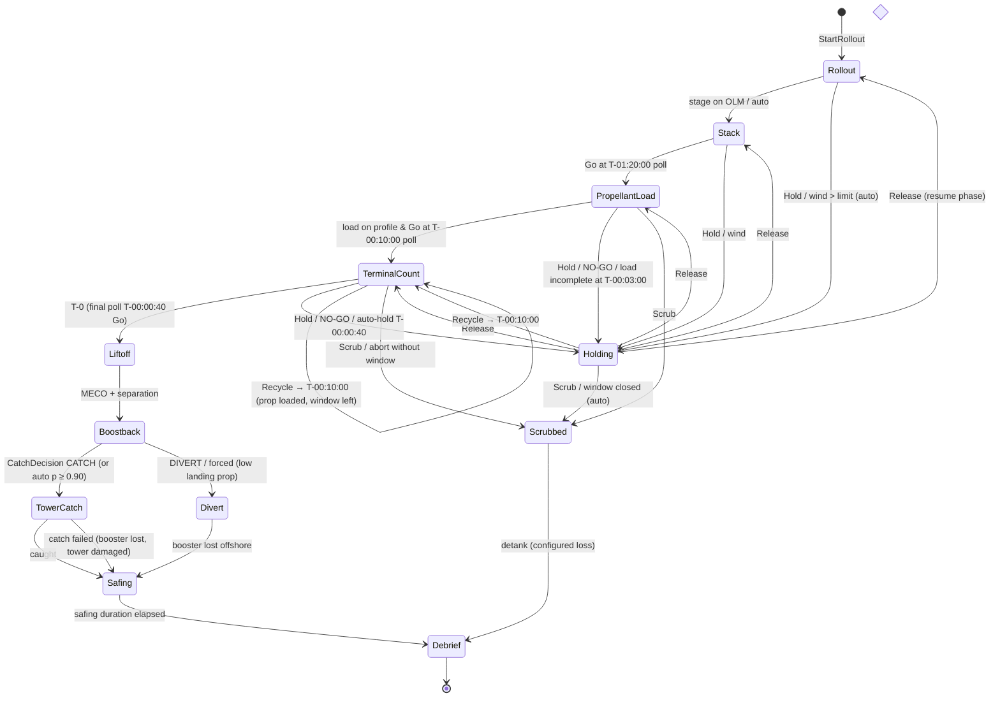

# Fuel-X — Architecture

> Owner: `systems-architect` · Status: Phase 1 draft (REV A), awaiting Gate 1.
> Decisions and their alternatives live in [`docs/adr/`](adr/). This document is the contract the
> other agents build against. Changing a contract here = update callers in the same commit.
> Inputs: [`GDD.md`](GDD.md) (entities, time rules, MVP), [`DESIGN_SYSTEM.md`](DESIGN_SYSTEM.md) (tokens),
> [`ASSETS_GUIDE.md`](ASSETS_GUIDE.md) (node/socket contract, per-asset budgets).

## 1. Chosen stack

| Layer | Choice (exact pin) | Rejected alternatives | Why | ADR |
|---|---|---|---|---|
| App / build | **Vite 8.3.1 SPA**, React 19.3.0, TypeScript 6.0.3 strict | Next.js 16 App Router (draft), Svelte/Solid, vanilla | Client-only game: SSR/RSC add `"use client"`/`ssr:false` friction and zero value; Vite = static `dist/`, workers, multi-page, shared config with Vitest | [0001](adr/0001-app-framework-and-build-tool.md) |
| Renderer | **three 0.186.1 `WebGLRenderer` (WebGL2)** | `WebGPURenderer` (+TSL) | iGPU/Linux availability, `postprocessing` support, stable SwiftShader screenshots; revisit Phase 8 | [0002](adr/0002-renderer.md) |
| Scene integration | **R3F 9.8.1** (`frameloop="never"`), drei 10.7.8 (whitelist), postprocessing 6.39.5 | Vanilla three scene manager | Declarative mount/dispose of entity views + shared React context with HUD; per-frame data path is imperative (`RenderSync`) | [0002](adr/0002-renderer.md) |
| Simulation | **Plain data-oriented TS world**, ordered system functions, in-house FSM + sfc32 RNG, **fixed 30 Hz** | koota, bitecs, miniplex, XState; `setInterval` loop (draft) | JSON-serializable world = free save/load + readable goldens; ≤ 2 000 entities needs no ECS | [0003](adr/0003-simulation-architecture.md) |
| Sim thread | **Main thread behind a worker-ready `SimHost`** | Worker from day 1 | Simplest debug/test path; move when sim > 4 ms/frame p95 at 100× | [0003](adr/0003-simulation-architecture.md) |
| State → UI | **10 Hz projection → Zustand 5.0.15 stores** | React state/context, Valtio, Jotai, Redux | Hard ceiling ≈ 10 React commits/s at any time scale; store usable outside React | [0004](adr/0004-state-to-ui-binding.md) |
| Styling | **CSS Modules + generated CSS vars**, Stylelint 17.15.0 rules | Tailwind 4 (draft), vanilla-extract, CSS-in-JS | Plain CSS for dense grids; lint mechanically bans radius/shadow/gradient/literal color | [0005](adr/0005-styling-and-design-tokens.md) |
| Tokens | **`src/tokens/tokens.ts` → CSS + JSON (sRGB + linear)** | Two hand-kept copies; Tailwind `@theme` | One source for HUD, three materials, Blender | [0005](adr/0005-styling-and-design-tokens.md) |
| Tests | **Vitest 5.0.1** (+coverage-v8, fast-check 4.10.2), **Playwright 1.56.1** | Jest, Cypress, Storybook | Shared Vite config; goldens via file snapshots; Playwright pinned to preinstalled Chromium r1194 | [0006](adr/0006-testing-stack.md) |
| Assets | **Blender 4.5.14 LTS bpy headless → glTF-Transform 4.5.0 + meshopt → codegen** | gltfjsx 6.5.3, Draco, GUI `.blend` | Reproducible from script; sockets preserved; typed node names for instancing/LOD | [0007](adr/0007-asset-pipeline-tooling.md) |
| Lint / format | ESLint 10.11.0 + typescript-eslint 8.70.1 + boundaries 7.2.0 + react-hooks 7.1.1, Prettier 3.9.9 | Biome | Import-boundary enforcement plugin exists only for ESLint | [0001](adr/0001-app-framework-and-build-tool.md) |
| Scripts | tsx 4.23.15 (Node 22) | ts-node, plain `.mjs` | Run typed build scripts without a compile step | [0001](adr/0001-app-framework-and-build-tool.md) |
| Deploy | **Static `dist/`, Cloudflare Pages** (GitHub Pages fallback) | Vercel, self-hosted | Headers file for caching/MIME, no lock-in | [0008](adr/0008-deployment-target.md) |

## 2. Modules and boundary rules

```
                    ┌──────────────────────── src/app (composition root) ───────────────────────┐
                    │  GameLoop (rAF)  ·  SimHost  ·  Projector (10 Hz)  ·  EventBus  ·  Persistence │
                    │  DebugHooks (window.__fuelx)  ·  TimeControl  ·  CameraDirector rules          │
                    └───▲───────────────┬───────────────────┬───────────────────┬───────────────────┘
          commands/save │               │ RenderSnapshot    │ UiProjection      │ SimEvents
                        │               ▼ (typed arrays)    ▼ (Zustand)         ▼ (bus)
 ┌───────────────┐   ┌──┴──────────┐  ┌──────────────┐  ┌─────────────┐   ┌──────────────┐
 │   src/sim     │   │ src/bridge  │  │  src/render  │  │   src/ui    │   │ (audio, later)│
 │ pure TS world │   │ stores +    │◄─┤ R3F scene,   │  │ HUD (React) │   └──────────────┘
 │ systems, FSMs │   │ command API │◄─┼──────────────┼──┤ /design pg  │
 │ (no DOM/three)│   │ (Zustand)   │  │ RenderSync,  │  └──────┬──────┘
 └──────▲────────┘   └─────────────┘  │ labels, fx   │         │
        │ JSON/TS data                └──────┬───────┘         │
 ┌──────┴────────┐   ┌──────────────┐        │ GLB + manifests │ CSS vars
 │   src/data    │   │  src/tokens  │◄───────┴─────────────────┘
 │ tunables,     │   │ tokens.ts →  │──► tokens.json ──► blender/lib/materials.py
 │ scenarios     │   │ css/json     │
 └───────────────┘   └──────────────┘        public/models/*.glb ◄── blender/assets/*.py (+ scripts/assets)
```

**Import rules** (enforced by `eslint-plugin-boundaries`; violations fail `npm run lint`):

| Module | May import | Must never import |
|---|---|---|
| `src/sim` | `src/sim`, `src/data` | three, react, zustand, DOM globals, `render`, `ui`, `bridge`, `app`, `tokens`; also banned: `Math.random`, `Date.now`, `performance.now`, `setTimeout/Interval`, `requestAnimationFrame` |
| `src/data` | nothing (pure data + its own types) | everything else |
| `src/tokens` | nothing | everything else |
| `src/bridge` | `zustand`, `import type` from `sim` | `render`, `ui`, `app`, three, react |
| `src/render` | three/R3F/drei/postprocessing, `bridge`, `tokens`, `import type` from `sim`, `render/assets/generated` | `ui`, `app`, runtime code from `sim` (except pure math utils in `sim/math`) |
| `src/ui` | react, `bridge`, `tokens`, `import type` from `sim` | three, R3F, `render`, `app`, runtime `sim` |
| `src/app` | everything | — (only module allowed to wire sim ↔ render ↔ ui) |
| `scripts/`, `tests/` | anything | being imported by `src/` |

Other rules: only `src/render/systems/**` may call `useFrame`; React components in `src/render/views/**` take an entity id, never telemetry props; UI never mutates the sim — it calls `commands.send()`.

## 3. Game loop, time scale, interpolation

Constants: `DT = 1/30 s` (`TICK_HZ = 30`), `MAX_FRAME_DT = 0.25 s`, `MAX_STEPS_PER_FRAME = 200`, `SIM_BUDGET_MS = 4`.
`GameLoop` owns the only wall clock (`performance.now()` lives in `src/app`, never in `sim`).

```ts
function frame(now: number) {
  const wallDt = Math.min((now - last) / 1000, MAX_FRAME_DT); last = now;
  const scale = time.effectiveScale();               // 0 | 1 | 10 | 100 | SKIP
  acc += wallDt * scale;
  let steps = 0; const t0 = now;
  while (acc >= DT && steps < MAX_STEPS_PER_FRAME && performance.now() - t0 < SIM_BUDGET_MS) {
    host.step();                                     // applies queued commands stamped for this tick, runs systems
    acc -= DT; steps++;
    if (time.shouldStop(host.lastTickEvents())) { acc = 0; break; }  // milestone / forced-1× rules
  }
  if (acc >= DT) { acc = 0; time.reportLag(steps); } // drop backlog → HUD shows effective rate (never bigger dt)
  const alpha = scale === 0 ? frozenAlpha : acc / DT; // interpolation factor in [0,1)
  bus.dispatch(host.drainEvents());                  // render fx, UI toasts, time rules
  projector.maybeRun(now);                           // 10 Hz or immediately on salient events
  r3f.advance(now);                                  // RenderSync lerps prev→curr with alpha
  requestAnimationFrame(frame);
}
```

- **Time scale** ∈ {PAUSE, 1×, 10×, 100×}: always more steps, never a bigger `dt`. GDD §6 rules (forced 1× from T-00:03:00 to catch/divert + 30 s; drop to 1× on decision prompt or NO-GO; never auto-raise; per-phase caps 10×/100×) live in `src/app/time/rules.ts` and react to `SimEvent`s; the sim itself reports `maxTimeScale` per phase from data.
- **Skip to next milestone** (GDD §6): scale `SKIP` runs steps for up to 12 ms per frame (rendering continues at low cost, HUD shows `SKIP`), until the sim emits a `Milestone`, `DecisionRequired` or `NoGo` event (`shouldStop`). Deterministic: same tick count as 1×.
- **Interpolation**: at the end of every tick the sim copies `curr → prev` and writes new `curr` transforms into the `RenderSnapshot`. `RenderSync` renders `lerp(prev, curr, alpha)` positions and `slerp` quaternions; discrete state (FSM) is never interpolated. On teleports (spawn, site switch) the sim sets a `snap` bit so prev = curr.
- **Pause**: sim stops; camera, labels, map controls and HUD interaction keep running.
- **Background tab**: rAF stops → `MAX_FRAME_DT` clamp → on return the game resumes, it does not fast-forward.

## 4. Per-tick data flow

```
UI click ──► commands.send(cmd) ──► SimHost queue ──stamp tick N+1──┐
                                                                    ▼
tick N+1:  1 applyCommands   (validated; rejected → CommandRejected event)
           2 environment     (weather series, sea state, forecast — rng:'weather')
           3 contracts/economy, scheduler (deliveries, tasks, director — rng:'director')
           4 countdown FSM   (T-clock, polls, holds, recycle/scrub, station GO/NO-GO)
           5 vehicle FSMs    (booster, ship, tower, transporter, crane, tankers, boats, vans)
           6 logistics/motion(path following, speeds, gate wait)
           7 propellant      (transfers farm↔vehicle, boil-off, topping) — mass-conserving
           8 flight dynamics (thrust, mass flow, drag, gravity; semi-implicit Euler)
           9 anomalies       (seeded rolls per exposure — rng:'anomaly')
          10 bookkeeping     (history samples 1 Hz, despawn, RenderSnapshot write, tick++)
                │ events[]                       │ RenderSnapshot             │ world (read-only)
                ▼                                ▼                            ▼
          EventBus (after batch)          RenderSync each frame       Projector ≤10 Hz → projectionStore
```

System order is a constant array in `src/sim/step.ts`; changing it is a golden-log change.

## 5. Event bus

- **Inside the sim**: no callbacks. Systems append typed `SimEvent`s to `world.outbox` (stamped with `tick`); later systems in the same tick may read events emitted earlier that tick. Every FSM transition emits an event. Events are part of the golden log.
- **Outside**: `SimHost.drainEvents()` hands the batch to `src/app/bus.ts`, a typed pub/sub (`bus.on('PhaseChanged', fn)`), dispatched once per frame after stepping. Subscribers: time rules, projector (salient → immediate projection), render fx (ignition, separation, arms closing, deluge), UI toasts/Events tab log, persistence (autosave on `Milestone`).
- Subscribers must not call back into the sim synchronously; they send commands.

```ts
type SimEvent =
  | { t: 'PhaseChanged'; tick: number; countdownId: Id; from: Phase; to: Phase }
  | { t: 'HoldStarted' | 'HoldReleased'; tick: number; countdownId: Id; reason: HoldReason }
  | { t: 'StationChanged'; tick: number; station: Station; status: GoStatus; driver: string }
  | { t: 'DecisionRequired'; tick: number; decision: DecisionKind; deadlineTick: number }
  | { t: 'AnomalyFired'; tick: number; anomaly: AnomalyId; entityId: Id }
  | { t: 'EntityStateChanged'; tick: number; id: Id; kind: Kind; from: string; to: string }
  | { t: 'Spawned' | 'Despawned'; tick: number; id: Id; kind: Kind }
  | { t: 'Milestone'; tick: number; name: MilestoneName }
  | { t: 'CommandRejected'; tick: number; cmd: Command['t']; reason: string };
```

## 6. Entity data model (shared types sketch)

Coordinates: **site-local, right-handed, Y-up, metres — identical to glTF/three** (X = east, Y = up, Z = south, so heading 0° = north = −Z). Sim and render therefore share frames; the only axis conversion in the project is Blender's exporter (Z-up → Y-up). Sim math is float64; render uses float32 with a floating origin (§13 risk 4).

```ts
// src/sim/types.ts — imported by render/ui with `import type` only
export type Id = string;                 // stable, e.g. 'e000123'; never the call-sign
export type Tick = number;               // integer
export interface Vec3 { x: number; y: number; z: number }
export interface Quat { x: number; y: number; z: number; w: number }
export interface FsmState<S extends string> { state: S; enteredTick: Tick }

interface Base<K extends Kind> {
  id: Id; kind: K; callSign: string; siteId: SiteId;
  pos: Vec3; rot: Quat; vel?: Vec3;      // SI
  slot: number;                          // index into RenderSnapshot arrays (stable while alive)
  asset: AssetKey;                       // e.g. 'booster' → render/assets/generated
}
export interface Booster extends Base<'booster'> {
  fsm: FsmState<BoosterState>;
  prop: { loxKg: number; ch4Kg: number; loxCapKg: number; ch4CapKg: number };
  engines: { total: 33; lit: number; failed: number[] };
  flight: { massKg: number; throttle: number; altitudeM: number; downrangeM: number } | null;
  wear: number; flights: number; history: HistoryEntry[];
}
export interface Ship extends Base<'ship'> { fsm: FsmState<ShipState>; prop: Booster['prop']; payloadKg: number }
export interface Tower extends Base<'tower'> { fsm: FsmState<TowerState>; arms: { angleRad: number; target: 'OPEN' | 'CLOSED' }; carriageM: number }
export interface Tank extends Base<'tank'> { fluid: 'LOX' | 'CH4' | 'LN2'; massKg: number; capKg: number; boilOffKgPerS: number }
export interface Tanker extends Base<'tanker'> { fluid: 'LOX' | 'CH4'; fsm: FsmState<TankerState>; cargoKg: number; route: RouteState }
export interface Transporter extends Base<'transporter'> { fsm: FsmState<TransporterState>; cargo: Id | null; route: RouteState }
export interface Crane extends Base<'crane'> { fsm: FsmState<CraneState>; slewRad: number; luffRad: number; hookM: number; load: Id | null }
export interface Boat extends Base<'boat'> { role: 'picket' | 'recovery' | 'intruder'; fsm: FsmState<BoatState>; route: RouteState }
export type Entity = Booster | Ship | Tower | Pad | Tank | Tanker | Transporter | Crane | Van | Boat | WxStation | Building;

export interface World {
  schema: number; tick: Tick; seed: number; rng: Record<RngStream, RngState>;
  sites: Record<SiteId, Site>;
  entities: { byId: Record<Id, Entity>; order: Id[]; nextSerial: number; freeSlots: number[] };
  countdowns: Record<Id, Countdown>;     // one per flight attempt
  contracts: Record<Id, Contract>; economy: { moneyCr: number; reputation: number };
  weather: WeatherState; anomalies: AnomalyState; outbox: SimEvent[];
}
export type Command =
  | { t: 'StartRollout'; boosterId: Id } | { t: 'Stack'; padId: Id }
  | { t: 'OrderDelivery'; fluid: 'LOX' | 'CH4'; rush: boolean }
  | { t: 'Go' | 'Hold' | 'Recycle' | 'Scrub'; countdownId: Id }
  | { t: 'CatchDecision'; boosterId: Id; choice: 'CATCH' | 'DIVERT' }
  | { t: 'LeakResponse'; choice: 'DEGRADED' | 'HOLD_FIX' };
```

Rules: no class instances, functions, `Map`/`Set`, `undefined`-vs-missing ambiguity or `NaN` in `World` (canonical JSON must round-trip). Iteration uses `entities.order` (insertion order) — never object key order of numeric-like keys. Tunables come from `src/data/*.ts` (typed, from BALANCING.md), never literals in systems.

**RenderSnapshot** (written by sim each tick, read by render; worker-transferable):
`prev`/`curr: Float32Array(maxSlots × 8)` = `x y z qx qy qz qw flags`; `anim: Float32Array(maxSlots × 8)` per-class channels (booster: throttle, engine-out mask lo/hi, gimbal; tower: armL, armR, carriage; crane: slew, luff, hook; transporter: deck, steer, wheelSpin; …) — channel layout per class lives in `src/sim/render-channels.ts`, mapped to node names by render; `index: { version, slots: {id, kind, asset, siteId}[] }` — bumps on spawn/despawn only (the only thing React views subscribe to).

## 7. State machines

Table-driven via `defineFsm` (`src/sim/core/fsm.ts`): `{ states, transitions: [{ from, to, on: CommandType | 'auto', guard(world, e), effect(world, e) }] }`. Every transition emits `EntityStateChanged`/`PhaseChanged`. Timers are `enteredTick + durationTicks` comparisons, not callbacks.

### 7.1 Countdown (one per flight attempt)



`Holding` stores `resumePhase` and `reason`; the **T-clock** (`tClockTicks`, negative before T-0) stops in `Holding`, while sim time, window time, topping drain and crew shift time continue (GDD AC 12). Phase bar segments map 1:1 to `Rollout … Safing`; `Holding`/`Scrubbed`/`Divert` are overlays (glyphs) on the current segment.

### 7.2 Vehicle classes (states per GDD §5.2)

| Class | States (→ = nominal order) | Off-nominal |
|---|---|---|
| Booster `B-` | IN_YARD → ON_TRANSPORTER → STACKED → LOADING → LOADED → ASCENT → BOOSTBACK → DESCENT → CAUGHT → SAFING → REFURB → IN_YARD | DIVERTED, LOST; LOADING ⇄ DETANKING (scrub) |
| Ship `S-` | IN_YARD → ON_TRANSPORTER → STACKED → LOADING → LOADED → ASCENT (attached) → SEPARATED → SECO → OFF_SCENE (despawn) | DETANKING, LOST |
| Tower `TOWER-` | IDLE → STACKING → IDLE → CATCH_READY → CATCHING → IDLE | DAMAGED; arms sub-FSM OPEN ⇄ CLOSING ⇄ CLOSED |
| Transporter `SP-` | IDLE → TO_PICKUP → LOADING → MOVING → POSITIONING → UNLOADING → RETURNING → IDLE | WIND_HOLD (from MOVING) |
| Crane `CR-` | IDLE → MOVING → LIFTING → HOLDING → LOWERING → IDLE | WIND_HOLD |
| Tanker `LX-`/`MX-` | OFFMAP → INBOUND → GATE_WAIT → OFFLOADING → OUTBOUND → OFFMAP | GATE_WAIT held while pad hazard closed (≥ T-00:40:00) |
| Picket `PK-` | DOCKED → PATROL → INTERCEPT → ESCORT → PATROL | — |
| Recovery `RV-` | DOCKED → TRANSIT → ON_STATION → RECOVERING → RETURNING | — |
| Intruder `UNK-` | SPAWN → IN_AREA → INTERCEPTED → LEAVING → despawn | — |
| Van `CV-` | PARKED → TO_PAD → AT_PAD → TO_SAFE → PARKED | — |

Each FSM has a table-driven test (allowed transitions fire, disallowed don't, each emits its event) per `sim-testing`.

## 8. UI projection contract

- `projectUi(world, prev, view) → UiProjection`, pure, in `src/app/projection/`, run **≤ 10 Hz** wall-clock + immediately on salient events (PhaseChanged, Hold*, StationChanged, DecisionRequired, AnomalyFired, Spawned/Despawned, selection/site/timescale change). Paused: on events only.
- Display units (km, km/h, %, t), rounding and fixed-width string formatting happen **here** (tested); UI components render strings/numbers verbatim with tabular figures. Machine SI values are kept alongside for `<data value>`.
- Structural sharing: unchanged rows/cards keep object identity so `useStore(store, selector, shallow)` bails out.
- Shape (abridged): `{ clock: {utc, tClock, missionClock, phase, holding, windowOpenAt, windowCloseAt}, timeScale: {requested, effective, maxAllowed, lagging}, range: {aggregate, stations[5]}, alerts: {open, items[]}, flightCard, inspector: InspectorVM | null, lists: {vehicles[], tanks[], tasks[], range[], events[]}, decision: DecisionVM | null, labels: {id, callSign, glyph, severity}[], sites[] }`.
- Sparklines: 120-sample ring buffers sampled at 1 Hz **sim** time inside the projector state.
- Freshness guarantee: displayed value ≤ 250 ms old while running (GDD AC 17).
- Per-frame DOM (label positions, altitude needle, compass heading) is written by `RenderSync`, not React.

## 9. Debug hooks — `window.__fuelx`

Installed by `src/app/debug.ts` when `import.meta.env.DEV` **or** the URL has `?debug=1` (so `perf-audit` can use a production build). Every method is safe to call from Playwright `page.evaluate`.

```ts
interface FuelxDebug {
  version: string;                                   // app + save schema
  ready(): Promise<void>;                            // assets loaded, first frame rendered
  seed(seed: number, opts?: { scenario?: 'mvp'; autopilot?: boolean }): Promise<void>; // new game, deterministic
  jumpTo(target: string | { tick: number } | { phase: Phase }): Promise<void>;
      // 'T-00:00:04' | 'T+00:01:45' | 'Liftoff': steps headless (no render) with the scenario autopilot
      // issuing the scripted decisions (same script as the golden test), then renders one frame
  pause(): void; resume(): void; setTimeScale(s: 0 | 1 | 10 | 100): void; step(n?: number): void;
  follow(callSign: string | null, opts?: { snap?: boolean }): void;  // snap = no camera lerp (screenshots)
  site(code: 'LC-1' | string): void;
  camera(preset: 'home' | 'frame' | { yawDeg: number; pitchDeg: number; distM: number }): void;
  freezeVisuals(on: boolean): void;                  // particles seeded by tick, wall clock fixed, noise static
  frames(n: number): Promise<void>;                  // resolve after n rendered frames
  state(): UiProjection;                             // assert surface for e2e
  stats(): { fps: number; frameMs: { median: number; p95: number }; drawCalls: number; triangles: number;
             points: number; geometries: number; textures: number; programs: number;
             simUsPerTick: { mean: number; p95: number }; simMsPerFrame: number; entities: number;
             tick: number; timeScale: number; effectiveTimeScale: number; reactCommitsPerS: number };
  save(): string; load(json: string): Promise<void>;
}
```

## 10. Save / load

- `save = { format: 'fuelx-save', schema: 1, game: '<app version>', createdAt: '<ISO, metadata only>', world: World, commandLog?: StampedCommand[] }`, canonical JSON (sorted keys at write), gzip via native `CompressionStream`.
- Storage: IndexedDB (thin in-house wrapper, store `saves`, keys `auto-<n>`, `slot-<n>`), plus export/import as `.fuelx.json.gz` file. Autosave on `Milestone` (debrief = natural save point, GDD §3) and on `visibilitychange → hidden`.
- **Versioning**: `schema` is an integer bumped on any `World` shape change; `src/sim/save/migrations.ts` holds `migrations[n]: (w_n) => w_{n+1}`, applied in order on load. Each migration ships with a fixture save under `tests/fixtures/saves/schema-<n>.json` and a test (load old fixture → migrate → validate → run 100 ticks without error). Saves newer than the app are rejected with a clear message.
- Equivalence test: run K ticks → save → load → M ticks ≡ K+M ticks (canonical-JSON hash).
- The `commandLog` (opt-in, on by default in dev) + seed reproduces a session for bug reports.

## 11. Token pipeline

```
docs/DESIGN_SYSTEM.md (values, authority)
        │ (ui-design-system edits)
src/tokens/tokens.ts  ──npm run tokens──►  src/tokens/generated/tokens.css   (:root { --fx-* }, imported once by main.tsx and design.tsx)
   │                                       src/tokens/generated/tokens.json  ({ srgb: '#F4F4F0', linear: [r,g,b] } per color + all scalars)
   │                                                    └──► blender/lib/materials.py materials_from_tokens(...)  (MAT_* colors, preview bg)
   └──► import { tokens } from '@tokens/tokens'  (render: background, fog, clay ramp, accent for exhaust/selection/rings)
```

Generated files are committed (Blender runs need them) and `npm run lint` runs `tokens --check` (fails if stale). ASSETS_GUIDE currently points Blender at `src/ui/tokens/tokens.json`; the path is **`src/tokens/generated/tokens.json`** (top-level so render can import tokens without importing UI).

## 12. Repo layout & scripts

```
index.html · design.html                  Vite entries (game, /design gallery)
src/
  main.tsx · design.tsx                   entry points
  app/       loop.ts, time/, sim-host/ (inline + worker-ready), projection/, bus.ts, persistence/, debug.ts, App.tsx
  bridge/    stores.ts (projectionStore, viewStore), commands.ts
  sim/       core/ (world, rng, fsm, events, commands, serialize), systems/, entities/ (factories),
             scenarios/ (mvp + autopilot script), save/ (migrations), math/, types.ts, step.ts, index.ts
  data/      balancing tunables (*.ts, typed), site layouts, phase/time-rule tables
  render/    Scene.tsx, systems/ (RenderSync, CameraRig, LabelLayer, Fx), views/ (per kind), materials/ (GLSL),
             world/ (sea/ground points, sky, lights), post/, assets/ (useAsset, generated/)
  ui/        hud/ (TopBar, FlightCard, Inspector, TabPanel, Timeline, DecisionStrip, MapControls…),
             components/ (primitives), design/ (gallery sections), glyphs/, *.module.css
  tokens/    tokens.ts, build.ts helpers, generated/{tokens.css,tokens.json}
tests/       golden/ (+ __files__), sim/ (equivalence, property), perf/ (benches), fixtures/saves/, e2e/ (Playwright: e2e, visual, perf)
blender/     lib/ (export, materials, preview, truss, tanks…), assets/<asset>.py + <asset>.contract.json
public/      models/*.glb (generated), fonts/*.woff2, _headers
docs/        GDD, BALANCING, ARCHITECTURE, adr/, DESIGN_SYSTEM, ASSETS_GUIDE, TASKS, QA, assets/ (previews)
scripts/     install-blender.sh, session-start.sh, tokens/build.ts, assets/{build,codegen,contract}.ts, perf/{budgets.ts,budget.json}
build/       git-ignored intermediates (models-raw/)
```

**npm scripts contract** (`package.json`, Phase 2):

| Script | Command |
|---|---|
| `dev` | `tsx scripts/tokens/build.ts && vite` |
| `build` | `tsx scripts/tokens/build.ts && vite build` |
| `preview` | `vite preview --port 4173 --strictPort` |
| `test` | `vitest run` (unit + FSM + golden + equivalence + property; `--project sim` subset possible) |
| `typecheck` | `tsc -p tsconfig.json --noEmit && tsc -p tsconfig.node.json --noEmit` |
| `lint` | `eslint . && stylelint "src/**/*.css" && prettier --check . && tsx scripts/tokens/build.ts --check` |
| `e2e` | `playwright test` (projects `e2e`, `visual`; `perf` project only via `npm run perf -- --browser`) |
| `asset` | `tsx scripts/assets/build.ts` → `npm run asset -- tower` (Blender → optimize → validate → codegen → preview) |
| `assets` | `tsx scripts/assets/build.ts --all` (`-- --verify` rebuilds twice, asserts byte-identical GLBs) |
| `perf` | `vitest bench --run tests/perf && tsx scripts/perf/budgets.ts` (bundle gzip + GLB size/tris vs `budget.json`; `-- --browser` adds the Playwright perf scenes on a production build) |
| `tokens` | `tsx scripts/tokens/build.ts` (helper, also run by dev/build/lint) |

ASSETS_GUIDE §8 names `scripts/asset.mjs`; the implementation path is `scripts/assets/build.ts` (TS, same behaviour).

## 13. Performance budget

**Reference machine**: mid-range laptop iGPU (Intel Iris Xe 96 EU / AMD Radeon 680M class), 1920×1080, DPR 1 (clamped `[1, 1.5]`), Chrome stable. **Target 60 fps**: median frame ≤ 16.7 ms, p95 ≤ 20 ms in the reference scenes (terminal count at LC-1 with everything on screen + exhaust; ascent following B-09; yard with logistics). Machine-readable copy: `scripts/perf/budget.json` (updated in the same commit as this table).

### 13.1 Frame and scene

| Metric | Budget |
|---|---|
| GPU frame time (reference iGPU) | ≤ 12 ms |
| Main-thread JS per frame (sim + RenderSync + R3F) | ≤ 6 ms at 1×; ≤ 8 ms at 100× |
| Draw calls — main pass | ≤ 200 |
| Draw calls — shadow pass | ≤ 60 (only large/hero casters; vans, props, points don't cast) |
| Triangles on screen (main pass) | ≤ 800 k (assets ≈ 160 k typical per ASSETS_GUIDE, leaves headroom for LOD0 close-ups) |
| Point cloud (sea + ground) | ≤ 300 k points, 2 draw calls, static buffers, GPU-animated |
| Particles (exhaust, foam, steam, deluge) | ≤ 20 k live sprites, ≤ 4 systems/draw calls, CPU update ≤ 1 ms |
| Shadow maps | 1 directional, 2048², updated every frame only while something moves near the pad, else static |
| Post-processing | 1 merged `EffectPass` (SMAA + halftone/dither), ≤ 1.5 ms GPU |
| Shader programs | ≤ 30 |
| GPU memory: textures + render targets | ≤ 96 MB (no asset textures by default) |
| DOM labels | ≤ 64 positioned per frame (declutter beyond) |
| React commits | ≤ 12 / s steady (0 scene commits/s when nothing spawns) |

### 13.2 Assets (adopts ASSETS_GUIDE §6 per-asset table; class limits below are hard caps)

| Class | Examples | LOD0 tris | LOD1 | LOD2 | GLB (LOD0, meshopt) | Draw calls (LOD0) |
|---|---|---|---|---|---|---|
| Hero structure | TOWER, PAD | ≤ 40 k | ≤ 12 k | ≤ 3 k | ≤ 500 KB | ≤ 10 |
| Hero vehicle | BOOSTER, SHIP | ≤ 20 k | ≤ 6 k | ≤ 1.5 k | ≤ 250 KB | ≤ 10 |
| Large machine / vessel | CRANE, VESSEL_RECOVERY | ≤ 20 k | ≤ 6 k | ≤ 1.5 k | ≤ 250 KB | ≤ 8 |
| Road / sea vehicle | TANKER, TRANSPORTER, BOAT_RANGE | ≤ 8 k | ≤ 2 k | — | ≤ 100 KB | ≤ 8 (transporter wheels instanced) |
| Building | HIGHBAY, MEGABAY, HANGAR_TENT | ≤ 5 k | ≤ 1.2 k | — | ≤ 70 KB | ≤ 4 |
| Repeated / prop | TANK_*, VAN, WX_STATION | ≤ 2.5 k | ≤ 600 | — | ≤ 40 KB | ≤ 2 — must be instanced when > 3 copies |

Total GLB payload for the MVP site ≤ 4 MB (estimate 2.5 MB). Textures: none by default; any texture needs an ADR (KTX2, ≤ 1024², ≤ 4 MB total).

### 13.3 Build and sim

| Metric | Budget |
|---|---|
| Initial JS (gzip) | ≤ 450 KB (three ≈ 170, react-dom ≈ 60, R3F+drei subset ≈ 50, postprocessing ≈ 25, app ≤ 145) |
| CSS (gzip) | ≤ 25 KB |
| Fonts | ≤ 150 KB WOFF2 total (subset, ≤ 4 files) |
| `/design` entry | separate chunk, not loaded by the game |
| Time to first interactive frame (preview, cold cache, local) | ≤ 3 s |
| Sim tick, MVP world (~45 entities + farm + flight) | ≤ 50 µs mean, ≤ 150 µs p95 (Node bench) |
| Sim tick, stress world (2 000 entities) | ≤ 400 µs mean |
| Sim per frame at 100× (≈ 50 steps) | ≤ 4 ms p95 → else move to worker (ADR 0003) |
| Entity capacity | MVP ≈ 45; designed for ≤ 2 000 across all sites; `maxSlots` 4 096 |
| Golden full-launch test runtime | ≤ 5 s |
| Save size (MVP) | ≤ 200 KB raw JSON |

## 14. Top technical risks

| # | Risk | Likelihood / impact | Mitigation |
|---|---|---|---|
| 1 | React creeps into the hot path (telemetry props, per-entity `useFrame`, `<Html>` labels) → frame drops | High / High | Lint: `useFrame` only in `render/systems`, drei whitelist; views take ids only; `perf-audit` checks React commits/s; `qa-perf` review |
| 2 | Determinism leaks (object key order, `Math.random`, wall clock, float accumulation of time, iteration over Sets) break goldens/saves | Medium / High | Lint bans; integer ticks; `entities.order`; per-system RNG streams; equivalence + 200-seed property tests in `npm run test` |
| 3 | Point-cloud sea/ground + particles + shadows exceed iGPU fill rate at 1080p | Medium / High | Budgets above; point size clamped, no overdraw-heavy blending (opaque dithered points); static shadow map; adaptive DPR; measure early in Phase 5 with the real point counts |
| 4 | Float32 jitter far from origin (booster at 68 km, RV-1 offshore) | Medium / Medium | Floating origin: render group re-centred on the followed entity each frame; sim in float64 |
| 5 | 100× time scale + skip saturates main thread as content grows | Medium / Medium | Step + ms caps with effective-rate display; benchmark in `npm run perf`; pre-approved worker migration (`SimHost` already async-shaped, snapshot is typed arrays) |
| 6 | Asset pipeline drift: renamed nodes/sockets, optimizer deleting empties, non-deterministic GLBs | Medium / Medium | Contract JSON per asset, codegen types break TS build on rename, `--verify` byte-identical rebuild, no `optimize` preset |
| 7 | Headless screenshots flaky (GPU/driver differences, animated noise, clocks) | Medium / Low | SwiftShader flags, `freezeVisuals`, masks, deterministic states via `__fuelx`, small diff threshold |
| 8 | Toolchain pin friction: Playwright tied to preinstalled Chromium r1194 (1.56.1), TS held at 6.0 by typescript-eslint | Low / Low | Documented pins; upgrade browser + Playwright together; revisit TS 7 when lint supports it |
| 9 | Save schema churn during development breaks old saves | High (dev) / Low | Integer schema + migrations with fixtures; pre-1.0 we may declare a reset in a migration note |

## 15. Open questions (for Gate 1)

1. Deployment: Cloudflare Pages account OK, or GitHub Pages (no custom headers)? (ADR 0008)
2. Reference hardware: confirm "Iris Xe / Radeon 680M class at 1080p" as the 60 fps target.
3. Firefox/Safari: first-class targets, or Chrome/Edge first with best-effort others? (Affects test matrix only; WebGL2 works everywhere.)
4. ASSETS_GUIDE alignment: token JSON path (`src/tokens/generated/tokens.json`) and pipeline script path (`scripts/assets/build.ts`) — blender-technical-artist to update the guide.
