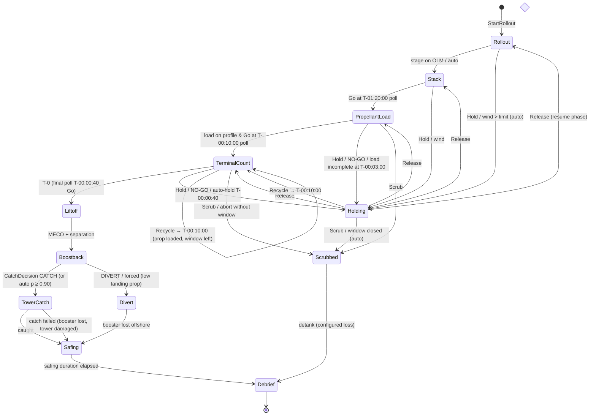

# Fuel-X — Architecture

> Owner: `systems-architect` · Status: Phase 1 draft (REV A), awaiting Gate 1.
> Decisions and their alternatives live in [`docs/adr/`](adr/). This document is the contract the
> other agents build against. Changing a contract here = update callers in the same commit.
> Inputs: [`GDD.md`](GDD.md) (entities, time rules, MVP), [`DESIGN_SYSTEM.md`](DESIGN_SYSTEM.md) (tokens),
> [`ASSETS_GUIDE.md`](ASSETS_GUIDE.md) (node/socket contract, per-asset budgets).

## 1. Chosen stack

| Layer | Choice (exact pin) | Rejected alternatives | Why | ADR |
|---|---|---|---|---|
| App / build | **Vite 8.3.1 SPA**, React 19.3.0, TypeScript 6.0.3 strict | Next.js 16 App Router (draft), Svelte/Solid, vanilla | Client-only game: SSR/RSC add `"use client"`/`ssr:false` friction and zero value; Vite = static `dist/`, workers, multi-page, shared config with Vitest | [0001](adr/0001-app-framework-and-build-tool.md) |
| Renderer | **three 0.186.1 `WebGLRenderer` (WebGL2)** | `WebGPURenderer` (+TSL) | iGPU/Linux availability, `postprocessing` support, stable SwiftShader screenshots; revisit Phase 8 | [0002](adr/0002-renderer.md) |
| Scene integration | **R3F 9.8.1** (`frameloop="never"`), drei 10.7.8 (whitelist), postprocessing 6.39.5 | Vanilla three scene manager | Declarative mount/dispose of entity views + shared React context with HUD; per-frame data path is imperative (`RenderSync`) | [0002](adr/0002-renderer.md) |
| Simulation | **Plain data-oriented TS world**, ordered system functions, in-house FSM + sfc32 RNG, **fixed 30 Hz** | koota, bitecs, miniplex, XState; `setInterval` loop (draft) | JSON-serializable world = free save/load + readable goldens; ≤ 2 000 entities needs no ECS | [0003](adr/0003-simulation-architecture.md) |
| Sim thread | **Main thread behind a worker-ready `SimHost`** | Worker from day 1 | Simplest debug/test path; move when sim > 4 ms/frame p95 at 100× | [0003](adr/0003-simulation-architecture.md) |
| State → UI | **10 Hz projection → Zustand 5.0.15 stores** | React state/context, Valtio, Jotai, Redux | Hard ceiling ≈ 10 React commits/s at any time scale; store usable outside React | [0004](adr/0004-state-to-ui-binding.md) |
| Styling | **CSS Modules + generated CSS vars**, Stylelint 17.15.0 rules | Tailwind 4 (draft), vanilla-extract, CSS-in-JS | Plain CSS for dense grids; lint mechanically bans radius/shadow/gradient/literal color | [0005](adr/0005-styling-and-design-tokens.md) |
| Tokens | **`src/tokens/tokens.ts` → CSS + JSON (sRGB + linear)** | Two hand-kept copies; Tailwind `@theme` | One source for HUD, three materials, Blender | [0005](adr/0005-styling-and-design-tokens.md) |
| Tests | **Vitest 5.0.1** (+coverage-v8, fast-check 4.10.2), **Playwright 1.56.1** | Jest, Cypress, Storybook | Shared Vite config; goldens via file snapshots; Playwright pinned to preinstalled Chromium r1194 | [0006](adr/0006-testing-stack.md) |
| Assets | **Blender 4.5.14 LTS bpy headless → glTF-Transform 4.5.0 + meshopt → codegen** | gltfjsx 6.5.3, Draco, GUI `.blend` | Reproducible from script; sockets preserved; typed node names for instancing/LOD | [0007](adr/0007-asset-pipeline-tooling.md) |
| Lint / format | ESLint 10.11.0 + typescript-eslint 8.70.1 (`no-restricted-imports` boundary matrix) + react-hooks 7.1.1, Prettier 3.9.9 | Biome, eslint-plugin-boundaries | Alias-aware boundary rules with type-only exceptions (ADR 0001 amendment) | [0001](adr/0001-app-framework-and-build-tool.md) |
| Scripts | tsx 4.23.15 (Node 22) | ts-node, plain `.mjs` | Run typed build scripts without a compile step | [0001](adr/0001-app-framework-and-build-tool.md) |
| Deploy | **Static `dist/` in nginx image, Coolify (self-hosted, user decision)** | Cloudflare Pages, GitHub Pages, Vercel | User-owned infra; headers/MIME/caching in committed `deploy/nginx.conf` | [0008](adr/0008-deployment-target.md) |

## 2. Modules and boundary rules

```
                    ┌──────────────────────── src/app (composition root) ───────────────────────┐
                    │  GameLoop (rAF)  ·  SimHost  ·  Projector (10 Hz)  ·  EventBus  ·  Persistence │
                    │  DebugHooks (window.__fuelx)  ·  TimeControl  ·  CameraDirector rules          │
                    └───▲───────────────┬───────────────────┬───────────────────┬───────────────────┘
          commands/save │               │ RenderSnapshot    │ UiProjection      │ SimEvents
                        │               ▼ (typed arrays)    ▼ (Zustand)         ▼ (bus)
 ┌───────────────┐   ┌──┴──────────┐  ┌──────────────┐  ┌─────────────┐   ┌──────────────┐
 │   src/sim     │   │ src/bridge  │  │  src/render  │  │   src/ui    │   │ (audio, later)│
 │ pure TS world │   │ stores +    │◄─┤ R3F scene,   │  │ HUD (React) │   └──────────────┘
 │ systems, FSMs │   │ command API │◄─┼──────────────┼──┤ /design pg  │
 │ (no DOM/three)│   │ (Zustand)   │  │ RenderSync,  │  └──────┬──────┘
 └──────▲────────┘   └─────────────┘  │ labels, fx   │         │
        │ JSON/TS data                └──────┬───────┘         │
 ┌──────┴────────┐   ┌──────────────┐        │ GLB + manifests │ CSS vars
 │   src/data    │   │  src/tokens  │◄───────┴─────────────────┘
 │ tunables,     │   │ tokens.ts →  │──► tokens.json ──► blender/lib/materials.py
 │ scenarios     │   │ css/json     │
 └───────────────┘   └──────────────┘        public/models/*.glb ◄── blender/assets/*.py (+ scripts/assets)
```

**Import rules** (enforced by typescript-eslint `no-restricted-imports` in `eslint.config.js`; violations fail `npm run lint`):

| Module | May import | Must never import |
|---|---|---|
| `src/sim` | `src/sim`, `src/data` | three, react, zustand, DOM globals, `render`, `ui`, `bridge`, `app`, `tokens`; also banned: `Math.random`, `Date.now`, `performance.now`, `setTimeout/Interval`, `requestAnimationFrame` |
| `src/data` | nothing (pure data + its own types) | everything else |
| `src/tokens` | nothing | everything else |
| `src/bridge` | `zustand`, `import type` from `sim` | `render`, `ui`, `app`, three, react |
| `src/render` | three/R3F/drei/postprocessing, `bridge`, `tokens`, `import type` from `sim`, `render/assets/generated` | `ui`, `app`, runtime code from `sim` (except pure math utils in `sim/math`) |
| `src/ui` | react, `bridge`, `tokens`, `import type` from `sim` | three, R3F, `render`, `app`, runtime `sim` |
| `src/app` | everything | — (only module allowed to wire sim ↔ render ↔ ui) |
| `scripts/`, `tests/` | anything | being imported by `src/` |

Other rules: only `src/render/systems/**` may call `useFrame`; React components in `src/render/views/**` take an entity id, never telemetry props; UI never mutates the sim — it calls `commands.send()`.

## 3. Game loop, time scale, interpolation

Constants: `DT = 1/30 s` (`TICK_HZ = 30`), `MAX_FRAME_DT = 0.25 s`, `MAX_STEPS_PER_FRAME = 200`, `SIM_BUDGET_MS = 4`.
`GameLoop` owns the only wall clock (`performance.now()` lives in `src/app`, never in `sim`).

```ts
function frame(now: number) {
  const wallDt = Math.min((now - last) / 1000, MAX_FRAME_DT); last = now;
  const scale = time.effectiveScale();               // 0 | 1 | 10 | 100 | SKIP
  acc += wallDt * scale;
  let steps = 0; const t0 = now;
  while (acc >= DT && steps < MAX_STEPS_PER_FRAME && performance.now() - t0 < SIM_BUDGET_MS) {
    host.step();                                     // applies queued commands stamped for this tick, runs systems
    acc -= DT; steps++;
    if (time.shouldStop(host.lastTickEvents())) { acc = 0; break; }  // milestone / forced-1× rules
  }
  if (acc >= DT) { acc = 0; time.reportLag(steps); } // drop backlog → HUD shows effective rate (never bigger dt)
  const alpha = scale === 0 ? frozenAlpha : acc / DT; // interpolation factor in [0,1)
  bus.dispatch(host.drainEvents());                  // render fx, UI toasts, time rules
  projector.maybeRun(now);                           // 10 Hz or immediately on salient events
  r3f.advance(now);                                  // RenderSync lerps prev→curr with alpha
  requestAnimationFrame(frame);
}
```

- **Time scale** ∈ {PAUSE, 1×, 10×, 100×}: always more steps, never a bigger `dt`. GDD §6 rules (forced 1× from T-00:03:00 to catch/divert + 30 s; drop to 1× on decision prompt or NO-GO; never auto-raise; per-phase caps 10×/100×) live in `src/app/time/rules.ts` and react to `SimEvent`s; the sim itself reports `maxTimeScale` per phase from data.
- **Skip to next milestone** (GDD §6): scale `SKIP` runs steps for up to 12 ms per frame (rendering continues at low cost, HUD shows `SKIP`), until the sim emits a `Milestone`, `DecisionRequired` or `NoGo` event (`shouldStop`). Deterministic: same tick count as 1×.
- **Interpolation**: at the end of every tick the sim copies `curr → prev` and writes new `curr` transforms into the `RenderSnapshot`. `RenderSync` renders `lerp(prev, curr, alpha)` positions and `slerp` quaternions; discrete state (FSM) is never interpolated. On teleports (spawn, site switch) the sim sets a `snap` bit so prev = curr.
- **Pause**: sim stops; camera, labels, map controls and HUD interaction keep running.
- **Background tab**: rAF stops → `MAX_FRAME_DT` clamp → on return the game resumes, it does not fast-forward.

## 4. Per-tick data flow

```
UI click ──► commands.send(cmd) ──► SimHost queue ──stamp tick N+1──┐
                                                                    ▼
tick N+1:  1 applyCommands   (validated; rejected → CommandRejected event; accepted → decision log)
           2 environment     (weather series, front, forecast — rng:'weather')
           3 range           (PICKET patrols/intercepts, crew vans, 5 stations @10 Hz → countdown inputs)
           4 countdown FSM   (T-clock, polls, holds, recycle/scrub, window)
           5 prep            (crane, transporter, tower stacking, wind pauses)
           6 logistics       (road closure, tanker orders/routes/gate/offload)
           7 propellant      (transfers farm↔vehicle, boil-off, topping, detank) — mass-conserving
           8 flight          (scripted profile, catch model, decision, outcome)
          8b tower           (carriage / catch arms / ship QD arm toward targets, carriage ⇄ QD interlock — 5.0)
           9 anomalies       (director + seeded rolls per exposure — rng:'director' / 'anomaly')
          9b economy         (books this tick's events: fees, contract, recovery, wear, debrief)
          10 bookkeeping     (tick++; RenderSnapshot write in 5.2)
                │ events[]                       │ RenderSnapshot             │ world (read-only)
                ▼                                ▼                            ▼
          EventBus (after batch)          RenderSync each frame       Projector ≤10 Hz → projectionStore
```

System order is a constant array in `src/sim/step.ts`; changing it is a golden-log change.

## 5. Event bus

- **Inside the sim**: no callbacks. Systems append typed `SimEvent`s to `world.outbox` (stamped with `tick`); later systems in the same tick may read events emitted earlier that tick. Every FSM transition emits an event. Events are part of the golden log.
- **Outside**: `SimHost.drainEvents()` hands the batch to `src/app/bus.ts`, a typed pub/sub (`bus.on('PhaseChanged', fn)`), dispatched once per frame after stepping. Subscribers: time rules, projector (salient → immediate projection), render fx (ignition, separation, arms closing, deluge), UI toasts/Events tab log, persistence (autosave on `Milestone`).
- Subscribers must not call back into the sim synchronously; they send commands.

```ts
// src/sim/core/events.ts (authoritative; abridged here)
type SimEvent =
  | { t: 'PhaseChanged'; tick; countdownId; from: Phase; to: Phase; trigger: string }
  | { t: 'HoldStarted'; tick; countdownId; reason: HoldReason; poll: PollId | null; tClockTicks }
  | { t: 'HoldReleased'; tick; countdownId; reason: HoldReason; by: 'GO' | 'AUTO' | 'RECYCLE'; tClockTicks }
  | { t: 'ClockChanged'; tick; countdownId; from: ClockState; to: ClockState; trigger }   // → Stopped
  | { t: 'PollOpened'; tick; countdownId; poll: PollId }
  | { t: 'PollPassed'; tick; countdownId; poll; auto: boolean; marginal: Station[] }
  | { t: 'Recycled'; tick; countdownId; fromTClockTicks; toTClockTicks }
  | { t: 'WindowMissed'; tick; countdownId; contractId; penaltyCr }
  | { t: 'StationChanged'; tick; countdownId; station: Station; status: GoStatus; driver: string }
  | { t: 'DecisionRequired'; tick; countdownId; decision: 'POLL' | 'CATCH' | 'LEAK'; poll: PollId | null; deadlineTick }
  | { t: 'AnomalyFired'; tick; countdownId; anomaly: AnomalyId; entityId: Id; source: 'NATURAL' | 'DIRECTOR' }
  | { t: 'LeakResponded'; tick; countdownId; choice: 'DEGRADED' | 'HOLD_FIX' }        // 3.7 A3
  | { t: 'LeakCleared'; tick; countdownId; by: 'FIXED' | 'LIFTOFF' }
  // 3.8 economy
  | { t: 'LedgerPosted'; tick; countdownId | null; item: LedgerItem; amountCr; reputationDelta; moneyCr; reputation }
  | { t: 'ContractUpdated'; tick; contractId; countdownId; status: 'ACTIVE' | 'FULFILLED' | 'WINDOW_MISSED' }
  | { t: 'DebriefReady'; tick; countdownId; outcome: 'CAUGHT' | 'DIVERTED' | 'CATCH_FAILED' | 'SCRUBBED'; moneyDeltaCr }
  | { t: 'EntityStateChanged'; tick; id: Id; kind: Kind; from: string; to: string }
  | { t: 'Spawned' | 'Despawned'; tick; id: Id; kind: Kind; callSign: string }
  | { t: 'Milestone'; tick; countdownId; name: MilestoneName }   // T-clock marks from src/data/countdown.ts
  | { t: 'CommandRejected'; tick; cmd: Command['t']; reason: string }  // reason = UPPER_SNAKE code (i18n key)
  // 3.4 logistics/propellant — money fields are charges the economy (3.8) applies
  | { t: 'DeliveryOrdered'; tick; orderId; tankerId; callSign; fluid; rush; cargoKg; feeCr; gateEtaTick }
  | { t: 'DeliveryCompleted'; tick; orderId; tankerId; fluid; deliveredKg; costCr; aborted }
  | { t: 'RoadClosureChanged'; tick; siteId; closed }
  | { t: 'DetankCompleted'; tick; countdownId; returnedKg: {LOX, CH4}; lostKg: {LOX, CH4} }
  // 3.5 prep · 3.6 flight
  | { t: 'ArmsChanged'; tick; id; from: 'OPEN' | 'CLOSED'; to: 'OPEN' | 'CLOSED' }
  // 5.0 tower mechanisms (heights m above the tower base)
  | { t: 'CarriageTargetSet'; tick; id; fromM; toM }
  | { t: 'CarriageArrived'; tick; id; atM }
  | { t: 'QdArmChanged'; tick; id; from: QdArmState; to: QdArmState }
  | { t: 'TowerInterlockChanged'; tick; id; from: TowerInterlock; to: TowerInterlock; carriageM }
  | { t: 'FlightEvent'; tick; countdownId; id; kind: 'booster' | 'ship'; event: FlightEventName; altitudeM; speedMPerS }
  | { t: 'EnginesChanged'; tick; id; lit; failed }
  | { t: 'RecoveryCommitted'; tick; countdownId; boosterId; mode: 'CATCH' | 'DIVERT'; by: 'PLAYER' | 'AUTO' | 'FORCED'; p }
  | { t: 'RecoveryOutcome'; tick; countdownId; boosterId; mode; result: 'CAUGHT' | 'CATCH_FAILED' | 'DIVERTED'; p; roll };
```

`world.tick` is the index of the **next** tick to execute; events emitted while executing it carry that
value, and bookkeeping increments it last. `step(world, commands) → SimEvent[]` returns that tick's events.

## 6. Entity data model (shared types sketch)

Coordinates: **site-local, right-handed, Y-up, metres — identical to glTF/three** (X = east, Y = up, Z = south, so heading 0° = north = −Z). Sim and render therefore share frames; the only axis conversion in the project is Blender's exporter (Z-up → Y-up). Sim math is float64; render uses float32 with a floating origin (§13 risk 4).

```ts
// src/sim/types.ts — imported by render/ui with `import type` only
export type Id = string;                 // stable, e.g. 'e000123'; never the call-sign
export type Tick = number;               // integer
export interface Vec3 { x: number; y: number; z: number }
export interface Quat { x: number; y: number; z: number; w: number }
export interface FsmState<S extends string> { state: S; enteredTick: Tick }

interface Base<K extends Kind> {
  id: Id; kind: K; callSign: string; siteId: SiteId;
  pos: Vec3; rot: Quat; vel?: Vec3;      // SI
  slot: number;                          // index into RenderSnapshot arrays (stable while alive)
  asset: AssetKey;                       // e.g. 'booster' → render/assets/generated
}
export interface Booster extends Base<'booster'> {
  fsm: FsmState<BoosterState>;
  prop: { loxKg: number; ch4Kg: number; loxCapKg: number; ch4CapKg: number };
  engines: { total: 33; lit: number; failed: number[] };
  flight: { massKg: number; throttle: number; altitudeM: number; downrangeM: number } | null;
  wear: number; flights: number; history: HistoryEntry[];
}
export interface Ship extends Base<'ship'> { fsm: FsmState<ShipState>; prop: Booster['prop']; payloadKg: number }
export interface Tower extends Base<'tower'> {     // as built 5.0 (src/sim/types.ts TowerFields)
  fsm: FsmState<TowerState>; arms: 'OPEN' | 'CLOSED'; task: TaskProgress | null;
  carriageM: number; carriageTargetM: number;      // TOWER_Carriage trans, m above the tower base (25–135)
  armLRad: number; armRRad: number;                // TOWER_ArmL 0 → +40°, TOWER_ArmR 0 → −40° (0 = closed), rad
  qd: 'STOWED' | 'ENGAGING' | 'ENGAGED' | 'RETRACTING'; qdArmRad: number;   // TOWER_QDArm 0 → π/2, rad
  interlock: 'NONE' | 'CARRIAGE_HELD' | 'QD_HELD';
}
export interface Tank extends Base<'tank'> { fluid: 'LOX' | 'CH4' | 'LN2'; massKg: number; capKg: number; boilOffKgPerS: number }
export interface Tanker extends Base<'tanker'> { fluid: 'LOX' | 'CH4'; fsm: FsmState<TankerState>; cargoKg: number; route: RouteState }
export interface Transporter extends Base<'transporter'> { fsm: FsmState<TransporterState>; cargo: Id | null; route: RouteState }
export interface Crane extends Base<'crane'> { fsm: FsmState<CraneState>; slewRad: number; luffRad: number; hookM: number; load: Id | null }
export interface Boat extends Base<'boat'> { role: 'picket' | 'recovery' | 'intruder'; fsm: FsmState<BoatState>; route: RouteState }
export type Entity = Booster | Ship | Tower | Pad | Tank | Tanker | Transporter | Crane | Van | Boat | WxStation | Building;

export interface World {
  schema: number; tick: Tick; seed: number; rng: Record<RngStream, RngState>;
  sites: Record<SiteId, Site>;
  entities: { byId: Record<Id, Entity>; order: Id[]; nextSerial: number; nextSlot: number; freeSlots: number[] };
  countdowns: Record<Id, Countdown>;     // one per flight attempt; iterate sorted ids (countdownIds())
  contracts: Record<string, ContractState>;   // by contract id (3.8)
  economy: { moneyCr; reputation; ledger: LedgerEntry[]; attempts: Record<Id, AttemptStart> };
  decisions: Record<Id, DecisionEntry[]>; debriefs: Record<Id, Debrief>;   // by countdown id (3.8)
  weather: WeatherState; config: SimConfig; range: Record<Id, RangeState>; anomalies: Record<Id, AnomalyState>;
  outbox: SimEvent[];
}
export type Command =
  | { t: 'StartRollout'; boosterId: Id } | { t: 'Stack'; padId: Id }
  | { t: 'OrderDelivery'; fluid: 'LOX' | 'CH4'; rush: boolean }
  | { t: 'Go'; countdownId: Id } | { t: 'Hold'; countdownId: Id }   // one member per type so Extract<> works
  | { t: 'Recycle'; countdownId: Id } | { t: 'Scrub'; countdownId: Id }
  | { t: 'CatchDecision'; boosterId: Id; choice: 'CATCH' | 'DIVERT' }
  | { t: 'LeakResponse'; choice: 'DEGRADED' | 'HOLD_FIX' };
```

Rules: no class instances, functions, `Map`/`Set`, `undefined`-vs-missing ambiguity or `NaN` in `World` (canonical JSON must round-trip). Iteration uses `entities.order` (insertion order) — never object key order of numeric-like keys. Tunables come from `src/data/*.ts` (typed, from BALANCING.md), never literals in systems.

**RenderSnapshot** (written by sim each tick, read by render; worker-transferable):
`prev`/`curr: Float32Array(maxSlots × 8)` = `x y z qx qy qz qw flags`; `anim: Float32Array(maxSlots × 8)` per-class channels (booster: throttle, engine-out mask lo/hi, gimbal; tower: armL, armR, carriage; crane: slew, luff, hook; transporter: deck, steer, wheelSpin; …) — channel layout per class lives in `src/sim/render-channels.ts`, mapped to node names by render; `index: { version, slots: {id, kind, asset, siteId}[] }` — bumps on spawn/despawn only (the only thing React views subscribe to).

## 7. State machines

Table-driven via `defineFsm` (`src/sim/core/fsm.ts`): `{ states, transitions: [{ from, to, on: CommandType | 'auto', guard(world, e), effect(world, e) }] }`. Every transition emits `EntityStateChanged`/`PhaseChanged`. Timers are `enteredTick + durationTicks` comparisons, not callbacks.

### 7.1 Countdown (one per flight attempt)



`Holding` stores `resumePhase` and `reason`; the **T-clock** (`tClockTicks`, negative before T-0) stops in `Holding`, while sim time, window time, topping drain and crew shift time continue (GDD AC 12). Phase bar segments map 1:1 to `Rollout … Safing`; `Holding`/`Scrubbed`/`Divert` are overlays (glyphs) on the current segment.

**Implementation (3.3, `src/sim/systems/countdown.ts`)** — the diagram above is realised as **two orthogonal table-driven FSMs** per countdown:
- **phase**: `Standby` (initial, before `StartRollout`) → `Rollout` → `Stack` → `PropellantLoad` → `TerminalCount` → `Liftoff` → `Boostback` → `TowerCatch | Divert` → `Safing` → `Debrief`, plus `Scrubbed` → `Debrief`.
- **clock**: `Counting ⇄ Holding → Stopped`; the T-clock advances only while `Counting`. `countdown.hold = { reason: MANUAL | POLL | NO_GO | LOAD_INCOMPLETE, poll }`.
- `Holding` is therefore not a phase: the phase *is* the `resumePhase`, and its physical work (stacking, loading, topping) continues under a hold — which is what makes the T-00:03:00 load auto-hold resolvable.
- **Polls** are holds with reason `POLL` opened when the T-clock reaches the poll mark; `Go` (or auto-GO when all 5 stations are GO and `autoGoWhenAllGreen`) passes them. Load poll needs `Stack` + stack complete; final poll needs T-0 inside the window. GO with MARGINAL stations records them in `countdown.goWithMarginal` (3.7 risk multiplier).
- **Auto-holds**: NO-GO station during `PropellantLoad`/`TerminalCount` (released only by player `Go`); load incomplete at T-00:03:00 (auto-released when complete + all GO).
- **Recycle** (from `TerminalCount`, past T-00:10:00, window open): T-clock → T-00:10:00, final poll re-run, any hold released (`by: 'RECYCLE'`).
- **Window close** before liftoff (held or not, any pre-liftoff phase) → `Scrubbed` + `WindowMissed { penaltyCr }`; economy applies it (3.8).
- Inputs owned by other systems are read from `countdown.inputs` (`stations`, `rolloutComplete`, `stackComplete`, `loadComplete`, `stageSeparated`, `recoveryMode`, `recoveryComplete`, `detankComplete`) — written by 3.4–3.7 before the next countdown tick.
- `maxTimeScale(world, countdown)` reports the per-phase cap from `src/data/time.ts` (holds ≤ 10×, forced 1× from T-00:03:00 to Safing + 30 s).

### 7.2 Vehicle classes (states per GDD §5.2)

| Class | States (→ = nominal order) | Off-nominal |
|---|---|---|
| Booster `B-` | IN_YARD → ON_TRANSPORTER → STACKING → STACKED → LOADING → LOADED → ASCENT → BOOSTBACK → DESCENT → CAUGHT_SAFING (→ REFURB → IN_YARD, post-MVP) | DIVERTED → LOST, LOST; LOADING/LOADED → DETANKING → STACKED (scrub) |
| Ship `S-` | IN_YARD → ON_TRANSPORTER → STACKING → STACKED → LOADING → LOADED → ASCENT (attached) → SEPARATED → SECO → OFF_SCENE (despawn) | DETANKING, LOST |
| Tower `TOWER-` | IDLE → STACKING → IDLE → CATCH_READY → CATCHING → IDLE | STACKING ⇄ WIND_HOLD; DAMAGED; arms OPEN ⇄ CLOSED (`ArmsChanged`; the angles move in the sim, §7.9); QD arm STOWED → ENGAGING → ENGAGED → RETRACTING → STOWED (`QdArmChanged`) |
| Transporter `SP-` | IDLE → LOADING → MOVING → AT_PAD → RETURNING → IDLE (MVP: SP-41 parks at the yard pickup) | WIND_HOLD (from MOVING / RETURNING) |
| Crane `CR-` | IDLE → LIFTING → IDLE (one timed task, `craneLoadTaskS`) | — (no crane wind limit in BALANCING) |
| Tanker `LX-`/`MX-` | OFFMAP → INBOUND → GATE_WAIT → OFFLOADING → OUTBOUND → OFFMAP | GATE_WAIT held while pad hazard closed (≥ T-00:40:00) |
| Picket `PK-` | PATROL → INTERCEPT → ESCORT → RETURNING → PATROL (DOCKED → PATROL unused in MVP) | — |
| Recovery `RV-` | ON_STATION (MVP: ambient, holding at the divert point) | TRANSIT / RECOVERING post-MVP |
| Intruder `UNK-` | IN_AREA (spawned in AREA BRAVO) → INTERCEPTED → LEAVING → despawn | — |
| Van `CV-` | AT_PAD (start) → TO_SAFE → PARKED → TO_PAD → AT_PAD | — |

Each FSM has a table-driven test (allowed transitions fire, disallowed don't, each emits its event) per `sim-testing`.
Tables live in `src/sim/entities/machines.ts`; implemented booster/ship states add `STACKING` (in the tower arms) and
`CAUGHT_SAFING` (one state for the `CAUGHT, SAFING` chip).

### 7.3 Prep (3.5, `src/sim/systems/prep.ts`)

- **World**: `world.prep[countdownId] = { towerId, transporterId, craneId, stackRequested }` (made by
  `createMvpFlight`); `world.weather = { groundWindMPerS, groundGustMPerS, towerWindMPerS, upperWindMPerS }` —
  current readings, calm (0) until the environment system (3.7) writes them each tick.
- **Rollout** (after `StartRollout`): CR-77 lifts B-09 onto SP-41 (`craneLoadTaskS`), SP-41 drives `sp.yardToOlm1`
  at `speedLoadedMPerS` → `AT_PAD`, `inputs.rolloutComplete`. Arrival = ceil(length / (speed·DT)) ticks after the
  lift ends.
- **Stack** (`Stack { padId }`, accepted once the booster is on the pad): TOWER-1 arms (CLOSED) take B-09 onto
  OLM-1 (`stackBoosterS`); SP-41 returns empty, CR-77 lifts S-21, SP-41 brings it; when B-09 is `STACKED` the arms put
  S-21 on top (`stackShipS`) → `inputs.stackComplete`. Rejections: `NO_COUNTDOWN_FOR_PAD`, `NO_PREP_ASSETS`,
  `NOT_IN_STACK_PHASE`, `ROLLOUT_NOT_COMPLETE`, `STACK_ALREADY_STARTED`.
- **Wind**: `groundGustMPerS > windLimit.transporterMPerS` → SP-41 `WIND_HOLD`; `> windLimit.stackMPerS` → tower
  `WIND_HOLD`. Tasks are progress counters, so a pause delays them by exactly its length; the T-clock is untouched.
- Prep runs in `Rollout … TerminalCount` and freezes once scrubbed.

### 7.4 Flight & recovery (3.6, `src/sim/systems/flight.ts`, `src/sim/math/{profile,catch}.ts`)

- **Profile**: booster keyframes (BALANCING §6) interpolated piecewise-linearly in *profile time*, which equals mission
  time except between an ascent engine-out and MECO (the remaining burn stretches by `ascentMecoDelayS` per engine).
  Ground track along `launchHeadingRad`; until a CATCH is committed the aim offset ramps to the offshore divert point
  (boostback start → landing burn); a CATCH converges it on the tower by the catch time. Divert profile = same keyframes
  to landing burn, then `SPLASHDOWN` at `divert.splashdownTS` on the divert point.
- **Entity fields**: booster `engines {total, lit, failed}`, `flight` (telemetry `altitudeM, downrangeM, speedMPerS,
  verticalSpeedMPerS, headingRad` + profile state), `recovery {p, sigmaM, landingPropKg, towerWindMPerS, forcedDivert,
  decisionRequiredTick, deadlineTick, mode, decidedBy, result, roll}` (live p for the UI); ship `engines`, `flight`.
  Booster propellant = profile − engine-out penalty, split by tank-capacity ratio.
- **Events / inputs**: `FlightEvent` per keyframe (LIFTOFF … CATCH | SPLASHDOWN; ship `SECO` = contract fulfilment).
  `HOT_STAGING` → S-21 `SEPARATED` (6 lit), `inputs.stageSeparated`. `BOOSTBACK_START` → `DecisionRequired
  {decision: 'CATCH', deadlineTick = landing-burn ignition}`. Commit (player/auto/forced) → `RecoveryCommitted`,
  `inputs.recoveryMode`, tower `CATCH_READY` (→ `CATCHING` at landing burn). Outcome → `RecoveryOutcome`,
  `inputs.recoveryComplete`. S-21 → `SECO` → next tick `OFF_SCENE` + despawn.
- **Catch model**: σ = base + perEngineOut·failed + windCoef·max(0, towerWind − windRef) + (landingProp < lowPropRef ?
  lowProp : 0), p = erf(tol / (σ√2)). "Landing prop" = predicted propellant at landing-burn ignition. Forced divert when
  landing prop < `landingMinPropKg` or tower wind > `towerWindLimitCatchMPerS` — committed as soon as the decision opens.
  No input by the deadline → CATCH iff p ≥ `autoCatchThreshold`. One roll on rng stream `catch` at the catch keyframe:
  `roll < p` → booster `CAUGHT_SAFING`, arms `CLOSED`, tower `IDLE`; else booster `LOST`, tower `DAMAGED`.
- **Commands**: `CatchDecision {boosterId, choice}` between `DecisionRequired` and the deadline; rejections
  `UNKNOWN_BOOSTER`, `NO_CATCH_DECISION_PENDING`, `ALREADY_DECIDED` (also after a forced divert).
- **Hook** `engineOut(world, boosterId, n = 1): boolean` (A4, 3.7): ascent → lit `33 − n`, MECO slip, landing-prop
  penalty; boostback → lit `13 − n`, boostback penalty; σ grows per engine out. No effect in other phases.

### 7.5 Logistics & propellant (3.4, `src/sim/systems/{logistics,propellant}.ts`)

- **World**: `world.logistics = { farm: {LOX, CH4, LN2: Id[]}, roadClosed, nextOrderSerial, charterSerial, loadRateFactor, ledger }`.
  `ledger[LOX|CH4]` books every kg: `deliveredKg`, `farmBoilOffKg`, `farmToVehicleKg`, `vehicleBoilOffKg`,
  `detankReturnedKg`, `detankLostKg` — farm + on-board + sinks − deliveries is constant (tested to 1e-12 relative).
- **Farm**: tanks spawned from the layout; start inventory split evenly; draws only above `heelFraction`, fills up to
  capacity, tank with most available first. Boil-off `m -= m·f·DT` per tick (LN2 static).
- **Orders** (`OrderDelivery`): standard = a free fleet truck (else `NO_TANKER_AVAILABLE`), rush = chartered truck
  spawned as the next serial (`LX-05`, `MX-03`, …) and despawned when it leaves. Lead time = order → arrival at the
  road gate; the truck leaves off-map `drive` ticks before. Fee in `DeliveryOrdered`, propellant price in
  `DeliveryCompleted` (for delivered kg). Offload at `offloadRateKgPerS` into the farm.
- **Road closure**: closed while any LC-1 countdown is pre-liftoff with T ≥ T-00:40:00, or in Liftoff…Safing.
  Inbound trucks reaching the gate wait in `GATE_WAIT`; a truck offloading when the road closes stops and leaves
  (`aborted: true`). Scrub/Debrief reopen the road.
- **Load**: in `PropellantLoad`/`TerminalCount` once T ≥ T-01:15:00, each of the 4 lines (booster/ship × LOX/CH4)
  fills at its rate × `loadRateFactor` (A3 hook) from the farm, for stages `STACKED|LOADING|LOADED`. Vehicle boil-off
  runs every tick before liftoff, so a full line tops exactly its boil-off. `inputs.loadComplete` = all 4 lines full.
- **Scrub**: stages → `DETANKING`, lines drain at the load rates, `scrubDetankLossFraction` vented, rest returned to
  the farm (overflow vented); when empty → `STACKED`, `inputs.detankComplete = true`, `DetankCompleted`.

### 7.6 Weather, range, anomalies (3.7, `src/sim/systems/{environment,range,anomalies}.ts`)

- **Config**: `world.config = { weather: 'SERIES' | 'MANUAL', stations: 'LIVE' | 'MANUAL', anomalies: boolean }`.
  `createWorld` defaults to MANUAL/MANUAL/false (unit tests force readings and stations); the `mvp` scenario
  (3.9) runs everything live.
- **Environment** (slot 2, rng `weather`): ground and upper wind are exact-discretised Ornstein–Uhlenbeck
  deviations (one Box–Muller pair per tick); gust = ground × `gustFactor`, tower = ground × `towerFactor`; a front
  (35 % of runs, arrival uniform scenario start → window close) adds a trapezoid boost to the upper wind.
  `weatherForecast(world, leadS)` = OU expectation ± `errorGrowth · lead`; a front is only forecast once it blows.
- **Range** (slot 3, before the countdown): PICKET loops (`lc1Layout.patrols`, patrol speed), A1 intercept
  (straight leg at `picketSpeed`, escort `clearAfterIntercept` s seaward, UNK-01 despawns, picket returns to its loop),
  crew vans (leave at `crew.vanDepartTS`, staggered, return after the attempt). Stations are evaluated at 10 Hz
  (`stationSampleS`) into `world.range[cd].stations[s] = { status, driver, value, limit }` (SI value of the driving
  quantity, `driver` = machine code for the UI) and copied to `cd.inputs.stations`; a worse status is kept until the
  value is `stationHysteresisFraction · limit` clear (deadband). `StationChanged` on status changes only.
  PROPELLANT = `propellantReserve()`: farm usable − (remaining load + boil-off while filling + topping from full to
  T-0), MARGINAL below 1 hold-hour of topping, NO-GO below 0.
- **Anomalies** (slot 9, after flight; rng `anomaly` for natural rolls, `director` for the plan): see the header of
  `anomalies.ts`. The director draws its guaranteed anomaly at the attempt's first tick (weighted) with a trigger
  inside the anomaly's window before T-00:30:00 (A4: a mission time in ascent or boostback); it is not cancelled by
  natural anomalies; the deadline rule is a fallback when the plan can no longer happen. A3 sets
  `logistics.loadRateFactor` (0.5 / 0 under HOLD_FIX) and `inputs.leakFixActive`; HOLD_FIX holds the count with
  reason `LEAK_FIX`, auto-released when the fix ends and no station is NO-GO. A4 calls `engineOut()`.
  GO-on-MARGINAL: `anomalies.marginalCategories[station]` lists the anomalies whose probability is ×
  `marginalRiskMultiplier` (WEATHER, VEHICLE → A4).
- **Command** `LeakResponse { choice }` → the countdown with an active leak; rejections `NO_ACTIVE_LEAK`,
  `ALREADY_RESPONDED`, `ALREADY_FIXING`.

### 7.8 Scenario `mvp` and autopilot (3.9, `src/sim/scenarios/`)

- `createMvpScenario({ seed, config? })` = `createWorld` (LIVE config) + `spawnSiteLayout` + `createMvpFlight`:
  LC-1 at T-06:00:00, NRL-3 `ACTIVE`, booster/ship in the yard, farm at the MVP start inventory.
- `autopilotCommands(world, countdownId, opts)` — stateless scripted director: StartRollout + orders in Standby,
  Stack once rolled out, GO whenever `releaseBlocker` is null (never on a LEAK_FIX hold), the configured leak
  response, the catch call once the booster is in DESCENT (CATCH iff p > `catchBreakEvenP()` = 1 − divert / failed
  catch cost). `STANDARD_AUTOPILOT` (3 LX + 1 MX standard, GO, HOLD_FIX, catch call) drives the golden test,
  the equivalence suites and `jumpTo`.
- Tests: `tests/golden/full-launch.test.ts` (seed 42 → `__files__/full-launch.seed42.log`), `tests/sim/equivalence`
  (save/load at two points, replay of the command log, uneven step batches), `tests/sim/properties` (200 fast-check
  cases from 6 snapshots), `scripts/sim/anomaly-sweep.ts` (AC 3, 200 full runs × 2 policies, not part of
  `npm run test`: ~4 min on 4 cores).

### 7.9 Tower mechanisms (5.0, `src/sim/systems/tower.ts`, `src/sim/math/tower.ts`, `src/data/tower.ts`)

- **State** (TowerFields): `carriageM` / `carriageTargetM` (m above the tower base), `armLRad` / `armRRad`, `qd` +
  `qdArmRad`, `interlock`. Render drives `TOWER_Carriage` / `TOWER_ArmL` / `TOWER_ArmR` / `TOWER_QDArm` straight from
  them (asset signs: L +, R −; QD 0 stowed → π/2 engaged). Each moves toward its target at `tower.{carriage.speedMPerS,
  arms.rateRadPerS, qdArm.rateRadPerS}` in slot 8b, landing exactly on the target.
- **Carriage height = pin height** (ASSETS_GUIDE sockets): booster stack `mountDeckM + boosterCatchPinM` = 86 m (=
  rest), ship stack `mountDeckM + booster.heightM + shipLiftPinM` = 135 m, catch `catchPoint.y + boosterCatchPinM` =
  126 m (booster origin at the CATCH altitude 60 m). Prep sets the stack target at stack start (`CarriageTargetSet`),
  a committed CATCH sets 126 m, the catch snaps the carriage there if the hoist was still moving.
- **QD arm**: target = engaged while a ship of a countdown served by the tower is STACKED / LOADING / LOADED /
  DETANKING; it therefore swings in after the ship stack and retracts at liftoff.
- **Interlock** (TOWER as-built): while `qd ≠ STOWED` the carriage stops on the `[keepOutLoM, keepOutHiM]` = 92–106 m
  band edge (`CARRIAGE_HELD`); the QD arm does not leave STOWED while the carriage is strictly inside the band
  (`QD_HELD`). QD runs before the carriage each tick, so "QD out ⇒ carriage outside the band" holds at every tick
  (unit tests + the fast-check property suite). Changes emit `TowerInterlockChanged`.
- Save schema 2 (migration 1 → 2 infers the mechanism state from the stack / flight progress).

### 7.7 Economy, contract, debrief (3.8, `src/sim/systems/economy.ts`)

- Runs last before bookkeeping and books **this tick's events** (`eventsThisTick`): `DeliveryOrdered.feeCr` →
  `HAULAGE_FEE`; `DeliveryCompleted.costCr` → `PROPELLANT_PURCHASE`; `DetankCompleted` → `PROPELLANT_LOST` (vented kg ×
  price); `WindowMissed` → `WINDOW_MISSED` + reputation, contract `WINDOW_MISSED`; ship `SECO` → contract `FULFILLED`,
  `CONTRACT_PRICE` + success reputation, `SHIP_EXPENDED`; booster `LIFTOFF` → `flights + 1`; `RecoveryOutcome` → wear
  (`perNominalFlight + engineOut·failed + highWindCatch`), `BOOSTER_REFURB` (caught) or `BOOSTER_LOST` (+ `TOWER_REPAIR`,
  `TOWER_DOWNTIME` = repair downtime × ops cost/day, reputation, on a failed catch); entering `Debrief` → `OPS_COST` for
  the attempt's sim duration and, for a commanded scrub, `WINDOW_MISSED` (the MVP does not play the rebook).
- Every posting: `economy.ledger` entry + `LedgerPosted` (balances after). Reputation clamped 0–100.
- **Decision log** `world.decisions[cd]`: accepted player commands (captured pre-apply: e.g. `Go` → `POLL LOAD,
  MARGINAL PROPELLANT`) plus automatic decisions from events (auto poll GO, AUTO/FORCED recovery, NO_GO /
  LOAD_INCOMPLETE holds, window-closed scrub), each `{ tick, tClockTicks, kind, detail, by }`.
- **Debrief** `world.debriefs[cd]` + `DebriefReady` on entering Debrief: outcome, contract status, money/reputation
  start/end/delta, ledger lines summed per item, booster (wear and flights before/after, engines out, state), tower
  state, recovery (mode, result, p, roll, decidedBy), propellant delivered/lost, anomalies, decisions, hold time,
  turnaround (refurb / tower repair / rebook).

## 8. UI projection contract

- `projectUi(world, prev, view) → UiProjection`, pure, in `src/app/projection/`, run **≤ 10 Hz** wall-clock + immediately on salient events (PhaseChanged, Hold*, StationChanged, DecisionRequired, AnomalyFired, Spawned/Despawned, selection/site/timescale change). Paused: on events only.
- Display units (km, km/h, %, t), rounding and fixed-width string formatting happen **here** (tested); UI components render strings/numbers verbatim with tabular figures. Machine SI values are kept alongside for `<data value>`.
- Structural sharing: unchanged rows/cards keep object identity so `useStore(store, selector, shallow)` bails out.
- Shape (abridged): `{ clock: {utc, tClock, missionClock, phase, holding, windowOpenAt, windowCloseAt}, timeScale: {requested, effective, maxAllowed, lagging}, range: {aggregate, stations[5]}, alerts: {open, items[]}, flightCard, inspector: InspectorVM | null, lists: {vehicles[], tanks[], tasks[], range[], events[]}, decision: DecisionVM | null, labels: {id, callSign, glyph, severity}[], sites[] }`.
- Sparklines: 120-sample ring buffers sampled at 1 Hz **sim** time inside the projector state.
- Freshness guarantee: displayed value ≤ 250 ms old while running (GDD AC 17).
- Per-frame DOM (label positions, altitude needle, compass heading) is written by `RenderSync`, not React.

## 9. Debug hooks — `window.__fuelx`

Installed by `src/app/debug.ts` when `import.meta.env.DEV` **or** the URL has `?debug=1` (so `perf-audit` can use a production build). Every method is safe to call from Playwright `page.evaluate`.

```ts
interface FuelxDebug {
  version: string;                                   // app + save schema
  ready(): Promise<void>;                            // assets loaded, first frame rendered
  seed(seed: number, opts?: { scenario?: 'mvp'; autopilot?: boolean }): Promise<void>; // new game, deterministic
  jumpTo(target: string | { tick: number } | { phase: Phase }): Promise<void>;
      // 'T-00:00:04' | 'T+00:01:45' | 'Liftoff': steps headless (no render) with the scenario autopilot
      // issuing the scripted decisions (same script as the golden test), then renders one frame.
      // Autopilot = `autopilotCommands(world, countdownId, STANDARD_AUTOPILOT)` from `src/sim/scenarios/autopilot.ts`:
      // stateless (derived from the world each tick), so jumping, replaying and save/load stay deterministic.
  pause(): void; resume(): void; setTimeScale(s: 0 | 1 | 10 | 100): void; step(n?: number): void;
  follow(callSign: string | null, opts?: { snap?: boolean }): void;  // snap = no camera lerp (screenshots)
  site(code: 'LC-1' | string): void;
  camera(preset: 'home' | 'frame' | { yawDeg: number; pitchDeg: number; distM: number }): void;
  freezeVisuals(on: boolean): void;                  // particles seeded by tick, wall clock fixed, noise static
  frames(n: number): Promise<void>;                  // resolve after n rendered frames
  state(): UiProjection;                             // assert surface for e2e
  stats(): { fps: number; frameMs: { median: number; p95: number }; drawCalls: number; triangles: number;
             points: number; geometries: number; textures: number; programs: number;
             simUsPerTick: { mean: number; p95: number }; simMsPerFrame: number; entities: number;
             tick: number; timeScale: number; effectiveTimeScale: number; reactCommitsPerS: number };
  save(): string; load(json: string): Promise<void>;
}
```

## 10. Save / load

- `save = { format: 'fuelx-save', schema: 2, game: '<app version>', createdAt: '<ISO, metadata only>', world: World, commandLog?: StampedCommand[] }`, canonical JSON (sorted keys at write), gzip via native `CompressionStream`.
- Storage: IndexedDB (thin in-house wrapper, store `saves`, keys `auto-<n>`, `slot-<n>`), plus export/import as `.fuelx.json.gz` file. Autosave on `Milestone` (debrief = natural save point, GDD §3) and on `visibilitychange → hidden`.
- **Versioning**: `schema` is an integer bumped on any `World` shape change; `src/sim/save/migrations.ts` holds `migrations[n]: (w_n) => w_{n+1}`, applied in order on load. Each migration ships with a fixture save under `tests/fixtures/saves/schema-<n>.json` and a test (load old fixture → migrate → validate → run 100 ticks without error). Saves newer than the app are rejected with a clear message.
- Equivalence test: run K ticks → save → load → M ticks ≡ K+M ticks (canonical-JSON hash).
- The `commandLog` (opt-in, on by default in dev) + seed reproduces a session for bug reports.
- **Implementation (3.10)**: `src/sim/save/save.ts` — `createSave(world, { game, createdAt, commandLog? })` (canonical
  JSON; `createdAt` comes from the host, the sim has no clock) and `loadSave(json, migrations?)` → `{ world, commandLog,
  game, createdAt, fromSchema }`; errors are codes `SAVE_NOT_JSON`, `SAVE_BAD_FORMAT`, `SAVE_FROM_NEWER_GAME`,
  `SAVE_MIGRATION_MISSING`, `WORLD_INVALID`. `src/sim/save/migrations.ts` — `MIGRATIONS` (1 → 2: tower mechanisms, 5.0) +
  `migrateWorld(raw, from, to, table)`. Fixture `tests/fixtures/saves/schema-1.json` (seed 42 at sim tick 540 000, under
  the A3 LEAK_FIX hold), written once by `scripts/sim/make-save-fixture.ts`. Compression / IndexedDB stay in
  `src/app/persistence` (8.3).

## 11. Token pipeline

```
docs/DESIGN_SYSTEM.md (values, authority)
        │ (ui-design-system edits)
src/tokens/tokens.ts  ──npm run tokens──►  src/tokens/generated/tokens.css   (:root { --fx-* }, imported once by main.tsx and design.tsx)
   │                                       src/tokens/generated/tokens.json  ({ srgb: '#F4F4F0', linear: [r,g,b] } per color + all scalars)
   │                                                    └──► blender/lib/materials.py materials_from_tokens(...)  (MAT_* colors, preview bg)
   └──► import { tokens } from '@tokens/tokens'  (render: background, fog, clay ramp, accent for exhaust/selection/rings)
```

Generated files are committed (Blender runs need them) and `npm run lint` runs `tokens --check` (fails if stale). ASSETS_GUIDE currently points Blender at `src/ui/tokens/tokens.json`; the path is **`src/tokens/generated/tokens.json`** (top-level so render can import tokens without importing UI).

## 12. Repo layout & scripts

```
index.html · design.html                  Vite entries (game, /design gallery)
src/
  main.tsx · design.tsx                   entry points
  app/       loop.ts, time/, sim-host/ (inline + worker-ready), projection/, bus.ts, persistence/, debug.ts, App.tsx
  bridge/    stores.ts (projectionStore, viewStore), commands.ts
  sim/       core/ (world, rng, fsm, events, commands, serialize), systems/, entities/ (factories),
             scenarios/ (mvp + autopilot script), save/ (migrations), math/, types.ts, step.ts, index.ts
  data/      balancing tunables (*.ts, typed), site layouts, phase/time-rule tables
  render/    Scene.tsx, systems/ (RenderSync, CameraRig, LabelLayer, Fx), views/ (per kind), materials/ (GLSL),
             world/ (sea/ground points, sky, lights), post/, assets/ (useAsset, generated/)
  ui/        hud/ (TopBar, FlightCard, Inspector, TabPanel, Timeline, DecisionStrip, MapControls…),
             components/ (primitives), design/ (gallery sections), glyphs/, *.module.css
  tokens/    tokens.ts, build.ts helpers, generated/{tokens.css,tokens.json}
tests/       golden/ (+ __files__), sim/ (equivalence, property), perf/ (benches), fixtures/saves/, e2e/ (Playwright: e2e, visual, perf)
blender/     lib/ (export, materials, preview, truss, tanks…), assets/<asset>.py + <asset>.contract.json
public/      models/*.glb (generated), fonts/*.woff2
deploy/      nginx.conf (Coolify image) · Dockerfile at repo root
docs/        GDD, BALANCING, ARCHITECTURE, adr/, DESIGN_SYSTEM, ASSETS_GUIDE, TASKS, QA, assets/ (previews)
scripts/     install-blender.sh, session-start.sh, tokens/build.ts, assets/{build,codegen,contract}.ts, perf/{budgets.ts,budget.json}
build/       git-ignored intermediates (models-raw/)
```

**npm scripts contract** (`package.json`, Phase 2):

| Script | Command |
|---|---|
| `dev` | `tsx scripts/tokens/build.ts && vite` |
| `build` | `tsx scripts/tokens/build.ts && vite build` |
| `preview` | `vite preview --port 4173 --strictPort` |
| `test` | `vitest run` (unit + FSM + golden + equivalence + property; `--project sim` subset possible) |
| `typecheck` | `tsc -p tsconfig.json --noEmit && tsc -p tsconfig.node.json --noEmit` |
| `lint` | `eslint . && stylelint "src/**/*.css" && prettier --check . && tsx scripts/tokens/build.ts --check` |
| `e2e` | `playwright test` (projects `e2e`, `visual`; `perf` project only via `npm run perf -- --browser`) |
| `asset` | `tsx scripts/assets/build.ts` → `npm run asset -- tower` (Blender → optimize → validate → codegen → preview) |
| `assets` | `tsx scripts/assets/build.ts --all` (`-- --verify` rebuilds twice, asserts byte-identical GLBs) |
| `perf` | `tsx scripts/perf/sim-bench.ts && tsx scripts/perf/budgets.ts` (sim timing harness + bundle gzip / GLB size vs `budget.json`; Playwright perf scenes added in Phase 5) |
| `tokens` | `tsx scripts/tokens/build.ts` (helper, also run by dev/build/lint) |

ASSETS_GUIDE §8 names `scripts/asset.mjs`; the implementation path is `scripts/assets/build.ts` (TS, same behaviour).

## 13. Performance budget

**Reference machine**: mid-range laptop iGPU (Intel Iris Xe 96 EU / AMD Radeon 680M class), 1920×1080, DPR 1 (clamped `[1, 1.5]`), Chrome stable. **Target 60 fps**: median frame ≤ 16.7 ms, p95 ≤ 20 ms in the reference scenes (terminal count at LC-1 with everything on screen + exhaust; ascent following B-09; yard with logistics). Machine-readable copy: `scripts/perf/budget.json` (updated in the same commit as this table).

### 13.1 Frame and scene

| Metric | Budget |
|---|---|
| GPU frame time (reference iGPU) | ≤ 12 ms |
| Main-thread JS per frame (sim + RenderSync + R3F) | ≤ 6 ms at 1×; ≤ 8 ms at 100× |
| Draw calls — main pass | ≤ 200 |
| Draw calls — shadow pass | ≤ 60 (only large/hero casters; vans, props, points don't cast) |
| Triangles on screen (main pass) | ≤ 800 k (assets ≈ 160 k typical per ASSETS_GUIDE, leaves headroom for LOD0 close-ups) |
| Point cloud (sea + ground) | ≤ 300 k points, 2 draw calls, static buffers, GPU-animated |
| Particles (exhaust, foam, steam, deluge) | ≤ 20 k live sprites, ≤ 4 systems/draw calls, CPU update ≤ 1 ms |
| Shadow maps | 1 directional, 2048², updated every frame only while something moves near the pad, else static |
| Post-processing | 1 merged `EffectPass` (SMAA + halftone/dither), ≤ 1.5 ms GPU |
| Shader programs | ≤ 30 |
| GPU memory: textures + render targets | ≤ 96 MB (no asset textures by default) |
| DOM labels | ≤ 64 positioned per frame (declutter beyond) |
| React commits | ≤ 12 / s steady (0 scene commits/s when nothing spawns) |

### 13.2 Assets (adopts ASSETS_GUIDE §6 per-asset table; class limits below are hard caps)

| Class | Examples | LOD0 tris | LOD1 | LOD2 | GLB (LOD0, meshopt) | Draw calls (LOD0) |
|---|---|---|---|---|---|---|
| Hero structure | TOWER, PAD | ≤ 40 k | ≤ 12 k | ≤ 3 k | ≤ 500 KB | ≤ 10 |
| Hero vehicle | BOOSTER, SHIP | ≤ 20 k | ≤ 6 k | ≤ 1.5 k | ≤ 250 KB | ≤ 10 |
| Large machine / vessel | CRANE, VESSEL_RECOVERY | ≤ 20 k | ≤ 6 k | ≤ 1.5 k | ≤ 250 KB | ≤ 8 |
| Road / sea vehicle | TANKER, TRANSPORTER, BOAT_RANGE | ≤ 8 k | ≤ 2 k | — | ≤ 100 KB | ≤ 8 (transporter wheels instanced) |
| Building | HIGHBAY, MEGABAY, HANGAR_TENT | ≤ 5 k | ≤ 1.2 k | — | ≤ 70 KB | ≤ 4 |
| Repeated / prop | TANK_*, VAN, WX_STATION | ≤ 2.5 k | ≤ 600 | — | ≤ 40 KB | ≤ 2 — must be instanced when > 3 copies |

Total GLB payload for the MVP site ≤ 4 MB (estimate 2.5 MB). Textures: none by default; any texture needs an ADR (KTX2, ≤ 1024², ≤ 4 MB total).

### 13.3 Build and sim

| Metric | Budget |
|---|---|
| Initial JS (gzip) | ≤ 450 KB (three ≈ 170, react-dom ≈ 60, R3F+drei subset ≈ 50, postprocessing ≈ 25, app ≤ 145) |
| CSS (gzip) | ≤ 25 KB |
| Fonts | ≤ 150 KB WOFF2 total (subset, ≤ 4 files) |
| `/design` entry | separate chunk, not loaded by the game |
| Time to first interactive frame (preview, cold cache, local) | ≤ 3 s |
| Sim tick, MVP world (~45 entities + farm + flight) | ≤ 50 µs mean, ≤ 150 µs p95 (Node bench) |
| Sim tick, stress world (2 000 entities) | ≤ 400 µs mean |
| Sim per frame at 100× (≈ 50 steps) | ≤ 4 ms p95 → else move to worker (ADR 0003) |
| Entity capacity | MVP ≈ 45; designed for ≤ 2 000 across all sites; `maxSlots` 4 096 |
| Golden full-launch test runtime | ≤ 5 s |
| Save size (MVP) | ≤ 200 KB raw JSON |

Measured by `npm run perf` (`scripts/perf/sim-bench.ts`, latest numbers in `docs/QA.md`): MVP 2.9 µs mean / 4.7 µs p95
per tick, 100× frame 0.22 ms p95, stress (2 000 entities) 76 µs mean, MVP save 17 KB.

## 14. Top technical risks

| # | Risk | Likelihood / impact | Mitigation |
|---|---|---|---|
| 1 | React creeps into the hot path (telemetry props, per-entity `useFrame`, `<Html>` labels) → frame drops | High / High | Lint: `useFrame` only in `render/systems`, drei whitelist; views take ids only; `perf-audit` checks React commits/s; `qa-perf` review |
| 2 | Determinism leaks (object key order, `Math.random`, wall clock, float accumulation of time, iteration over Sets) break goldens/saves | Medium / High | Lint bans; integer ticks; `entities.order`; per-system RNG streams; equivalence + 200-seed property tests in `npm run test` |
| 3 | Point-cloud sea/ground + particles + shadows exceed iGPU fill rate at 1080p | Medium / High | Budgets above; point size clamped, no overdraw-heavy blending (opaque dithered points); static shadow map; adaptive DPR; measure early in Phase 5 with the real point counts |
| 4 | Float32 jitter far from origin (booster at 68 km, RV-1 offshore) | Medium / Medium | Floating origin: render group re-centred on the followed entity each frame; sim in float64 |
| 5 | 100× time scale + skip saturates main thread as content grows | Medium / Medium | Step + ms caps with effective-rate display; benchmark in `npm run perf`; pre-approved worker migration (`SimHost` already async-shaped, snapshot is typed arrays) |
| 6 | Asset pipeline drift: renamed nodes/sockets, optimizer deleting empties, non-deterministic GLBs | Medium / Medium | Contract JSON per asset, codegen types break TS build on rename, `--verify` byte-identical rebuild, no `optimize` preset |
| 7 | Headless screenshots flaky (GPU/driver differences, animated noise, clocks) | Medium / Low | SwiftShader flags, `freezeVisuals`, masks, deterministic states via `__fuelx`, small diff threshold |
| 8 | Toolchain pin friction: Playwright tied to preinstalled Chromium r1194 (1.56.1), TS held at 6.0 by typescript-eslint | Low / Low | Documented pins; upgrade browser + Playwright together; revisit TS 7 when lint supports it |
| 9 | Save schema churn during development breaks old saves | High (dev) / Low | Integer schema + migrations with fixtures; pre-1.0 we may declare a reset in a migration note |

## 15. Open questions (for Gate 1)

1. ~~Deployment~~ — resolved at Gate 1: Coolify (ADR 0008).
2. Reference hardware: confirm "Iris Xe / Radeon 680M class at 1080p" as the 60 fps target.
3. Firefox/Safari: first-class targets, or Chrome/Edge first with best-effort others? (Affects test matrix only; WebGL2 works everywhere.)
4. ASSETS_GUIDE alignment: token JSON path (`src/tokens/generated/tokens.json`) and pipeline script path (`scripts/assets/build.ts`) — blender-technical-artist to update the guide.
