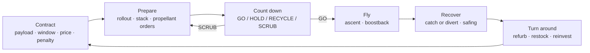

# Fuel-X — Game Design Document

> Owner: `game-designer` · Status: Phase 1 draft (REV A) · Numbers live in [`BALANCING.md`](BALANCING.md) and end up in `src/data/*`, never in systems code.
> Vocabulary: **sim time** = simulated seconds; **T-** / **T+** = countdown clock relative to liftoff; **cr** = credits (1 cr is about 1 USD for order of magnitude).

---

## 1. Pitch

**You are the launch director of a growing coastal spaceport.** You win launch contracts, then get a huge reusable methane/LOX rocket to the pad, fuelled, counted down, launched, and its booster caught back by the tower arms. Then you turn the whole thing around faster than last time.

You never fly the rocket. You decide **when**, **whether** and **how much risk**. The drama comes from logistics (is the tank farm full enough to survive a hold?), timing (the window closes in 23 minutes and the upper winds are rising), and risk (one engine out on boostback, so do you still try the catch?). The world keeps moving around you: tankers shuttle, transporters crawl, picket boats patrol, and the clock keeps ticking.

One sentence: *a calm, readable strategy game about cadence and risk, set in a live rocket launch site.*

## 2. Design pillars

| # | Pillar | Means | Kills |
|---|---|---|---|
| P1 | **Decisions, not reflexes** | Every alert is answered with a *choice* that has a cost on both sides. You can always pause. No input needs speed or aim. | QTEs, manual piloting, "click fast" prompts |
| P2 | **Logistics are the plot** | Propellant, vehicles, crews and pad time are finite, physical and visible (a tanker you can follow). Most failures trace back to a logistics call made hours earlier. | Abstract resource bars without a physical source |
| P3 | **Grounded, simplified aerospace** | Real orders of magnitude (thousands of tonnes, tens of minutes, a few metres of catch tolerance), real phase names, simple models. | Fantasy tech, fake precision, physics the player can't read |
| P4 | **Cadence is the score** | Success is measured in turnaround time and reliability across many flights, not one perfect launch. | One-shot spectacle loops |

A widget, mechanic or entity that does not serve a pillar is cut, or kept only as cheap ambience and labelled that way.

## 3. Loops

### 3.1 Core loop (one flight)

```
        +--------------------------------------------------------------+
        |                                                              |
        v                                                              |
  [1 CONTRACT] --> [2 PREPARE] --> [3 COUNT DOWN] --> [4 FLY] --> [5 RECOVER] --> [6 TURN AROUND]
   accept:          rollout,        polls: GO /        watch,       catch or        refurbish,
   payload,         stack,          HOLD / RECYCLE /   react to     divert,         restock,
   window,          order prop,     SCRUB              anomalies,   safing,         reinvest
   price,           schedule        (window clock)     catch call   damage roll     |
   penalty          tankers                                                         |
        ^                                                                           |
        +---------------------- money, reputation, flight-proven hardware ---------+
```



The player's leverage is concentrated at **four decision points per flight**:
1. **Propellant margin** (Prepare): how much to stock and when to receive it.
2. **Go / No-Go** (Count down): commit, hold, recycle or scrub against a closing window.
3. **Catch or divert** (Fly): bet the booster and tower, or give up the booster.
4. **Reinvest** (Turn around, meta only): where the money goes.

### 3.2 Session loop (20–40 min real time)

One session is about one flight: pick or continue a contract, then compress through preparation (logistics run fast), drop to 1× for the terminal count and flight, compress through safing, read the debrief, and queue the next turnaround. Natural save point: after the debrief.

### 3.3 Meta loop (campaign, post-MVP)

Contracts pay money and reputation. Reputation unlocks bigger contracts (heavier payloads, tighter windows, higher pay). Money buys capacity: more tankers, more storage, a second pad, faster crews, better forecasting, an air-separation unit. Every booster accumulates **flight count + wear + history**, and a fleet of flight-proven boosters is the long-term asset. The campaign score is **cadence**: rolling mean turnaround time and on-time rate over the last N flights.

## 4. Mechanics

Format for each: **Decision** · **Inputs** · **Outputs** · **Trade-off** · **Failure mode** · **HUD surface**.

### 4.1 Contracts
- **Decision**: which contract to accept (post-MVP: from a board of 3). In the MVP the contract is pre-accepted and only displayed.
- **Inputs**: payload mass (t), target orbit (label only), window open time + duration, price, missed-window penalty, loss penalty, reputation gate.
- **Outputs**: on success: price paid in full + reputation gain. Window missed: penalty + one rebook (next window, +24 h). Payload lost: loss penalty + big reputation hit.
- **Trade-off**: a high price comes with a tight window and a high penalty.
- **Failure mode**: accepting a contract whose window lands before your propellant or vehicles can be ready.
- **HUD**: flight card header `[ LC-1 FLIGHT 7 ]`, Tasks tab (contract row), Events.

### 4.2 Vehicle preparation (rollout and stack)
- **Decision**: when to start each prep task, and in which order (booster first, ship second). Post-MVP: which booster to fly (wear versus availability).
- **Inputs**: vehicle state (`IN_YARD`, `READY_FOR_ROLLOUT`), transporter availability (SP-41), crane (CR-77) to load the transporter, tower arms free, crew shift.
- **Outputs**: the vehicle moves yard → pad on the transporter (visible, followable), the tower arms lift it onto the launch mount (booster) or onto the booster (ship). Stages-ready count increments.
- **Trade-off**: stacking early frees the end of the day but exposes the stack to weather (wind on a stacked vehicle above the destack limit forces a destack). Stacking late risks the stack becoming the critical path into the window.
- **Failure mode**: a wind gust above the stack limit while the vehicle is in the arms → task paused (hold) until the wind drops. The transporter cannot move above its wind limit either.
- **HUD**: Tasks tab (task rows with progress, Start button), inspector for SP-41 / CR-77 / TOWER-1, countdown timeline phases `Rollout`, `Stack`.

### 4.3 Propellant logistics (tank farm and tankers)
- **Decision**: how many deliveries to order (standard or rush), and when, so they arrive before the road closes. Run lean (cheap) or build margin (costly, but survives holds and a recycle).
- **Inputs**: farm inventories (LOX, CH4), farm capacity, farm boil-off, tanker fleet (LX-xx LOX, MX-xx CH4), round-trip time to the off-map supplier, offload rate, road closure rule (no tanker inside the pad hazard radius from T-00:40:00 until Safing ends).
- **Outputs**: tankers drive in, offload, and leave. Farm level rises. Cost is charged per tonne delivered (+ rush premium).
- **Trade-off**: margin versus cash, and the timing of the road closure. A delivery that arrives after the closure waits at the gate and does not count for this attempt. In the MVP the sharp edge is **information versus lead time**: standard trucks must be ordered before the 3 h forecast can see the window (blind hedge), while rush trucks can wait for the forecast but cost 20×. The farm starts lean (~31 min of holds, PROPELLANT MARGINAL); the whole standard LX fleet (4 LX + 1 MX) turns it GO at ~66 min, still short of the 75-min hold budget (BALANCING §13.1).
- **Failure mode**: farm too low to complete the load, to top off through a hold, or to reload after a scrub → propellant station NO-GO → forced scrub. The window is lost, with its penalty.
- **HUD**: Tanks tab (each tank: level %, tonnes, boil-off rate), Vehicles tab (tankers: state, ETA, km/h), flight card propellant sparkline, Tasks tab (Order delivery action).

### 4.4 Propellant load (vehicle fuelling)
- **Decision**: (a) when to give GO for propellant load (it starts a commitment, because from then on the vehicle boils off and is topped from the farm); (b) during a load anomaly (GSE leak, D3b): continue at reduced rate or hold to fix. D3b is one-shot; with no answer the load continues degraded (auto policy, §13.2).
- **Inputs**: vehicle tank capacities, load rates per stage and per propellant, farm inventories, GO poll at T-01:20:00.
- **Outputs**: vehicle loaded % rises (booster and ship separately, LOX and CH4 separately). After 100 %, topping replaces boil-off and drains the farm.
- **Trade-off**: an early load gives schedule slack but burns farm margin through topping. A late load risks not finishing before the window closes.
- **Failure mode**: load not complete at T-00:03:00 → automatic hold. Farm drained → propellant NO-GO.
- **HUD**: flight card `PROPELLANT LOADED %` + sparkline, inspector (booster/ship propellant metrics), countdown phase `Propellant load`, Tanks tab.

### 4.5 Countdown and Go / No-Go polls
- **Decision**: **the central decision of the game.** At each poll and at any time during the count: **GO**, **HOLD**, **RECYCLE** or **SCRUB**.
- **Inputs**: five stations, each GO / MARGINAL / NO-GO:

  | Station | GO when | MARGINAL when | NO-GO when |
  |---|---|---|---|
  | WEATHER | ground wind, upper wind, lightning within limits | within 15 % of a limit, or forecast to cross it within the window | over a limit, or lightning within radius |
  | RANGE | hazard area clear of boats and road traffic, pickets on station | picket boat repositioning | intruder in hazard area, picket off station |
  | PROPELLANT | load on profile, farm ≥ topping reserve | farm reserve < 1 hold-hour | load fault, farm below reserve |
  | VEHICLE | no faults, health ≥ threshold | soft fault (sensor disagree) | hard fault (leak, engine chill fail) |
  | PAD / CREW | pad clear, crews out of the hazard radius, crew within shift limit | crew near shift limit | crew in hazard radius, crew over limit |

- **Outputs**:
  - **GO**: the clock runs. A MARGINAL station allowed through applies a risk multiplier (see §7).
  - **HOLD**: the clock stops. The window keeps closing in real (sim) time. Topping keeps draining the farm. Crew shift time keeps accruing.
  - **RECYCLE**: return to T-00:10:00 (needs propellant still loaded and window remaining). Costs time only.
  - **SCRUB**: detank (part of the propellant is lost), stand down. Next attempt is the rebook window (+24 h), with the window-miss penalty if the contract window is lost.
- **Trade-off**: hold for the weather to clear while the window shrinks and the farm drains, versus GO on MARGINAL for a raised anomaly risk, versus scrub (certain penalty, safe vehicle).
- **Failure mode**: the window closes during a hold → automatic scrub + penalty. Going on MARGINAL raises the chance of an ascent anomaly.
- **HUD**: top bar `Range GO` badge (aggregate of the five stations), flight card `STATIONS GO 4 of 5` segmented bar, **Range tab** (one row per station with its driving value), **decision strip** (new component, see §10), countdown timeline with hold glyph.
- **Vocabulary (fixed)**: a *station* is only ever **GO / MARGINAL / NO-GO** (plus `POLLING` while a poll resolves). **HOLD / HOLDING** is only ever a state of the *T-clock* (with a reason: `POLL`, `NO_GO`, `LOAD_INCOMPLETE`, `LEAK_FIX`, `MANUAL`), never a station status. The top-bar badge is the worst of the five stations: `RANGE GO | MARGINAL | NO-GO`.
- **One command surface per moment (fixed)**: while the clock is **counting**, the only count button is **HOLD**, in the countdown timeline header. While the clock is **holding** (pre-liftoff, any reason), the only count buttons are **GO / RECYCLE / SCRUB**, in the D2 decision strip; the timeline header shows the hold glyph and reason, no buttons. The Range tab and the poll panel are evidence only. To scrub from a running count: HOLD, then SCRUB.

### 4.6 Terminal count and liftoff
- **Decision**: none new (polls continue). Automatic hold point at T-00:00:40 for a final poll. An auto-abort after T-00:00:10 (vehicle fault) forces a RECYCLE if the window allows.
- **Inputs/outputs**: GSE retracts, final chill, engine ignition at T-00:00:03, liftoff at T-0.
- **HUD**: countdown hero number, timeline playhead, camera auto-follows the booster (player can override).

### 4.7 Ascent, staging, boostback (simplified flight)
- **Decision**: none during nominal flight. React to anomalies only (§7). The player watches telemetry that will justify the catch call.
- **Model**: scripted nominal profile (altitude/velocity/propellant tables from BALANCING) plus perturbations: engine-out reduces thrust and propellant margin; upper-wind adds loads. No free-form physics.
- **Events**: Max-Q, MECO, hot staging, boostback start/end, ship SECO (contract fulfilment event), booster apogee, landing burn, catch.
- **HUD**: inspector (altitude, velocity, propellant, engines lit `33 of 33`, heading, mission clock), inspector line chart (altitude km / propellant %), progress bar `FLIGHT TO TOWER CATCH 41.2 %`, altitude scale, compass tape.

### 4.8 Recovery: tower catch or divert
- **Decision**: **GO FOR CATCH** or **DIVERT** (offshore splashdown, booster expended). Deadline: landing-burn ignition. The booster flies an offshore aim point by default and only crosses to the tower on a GO, as the real approach does.
- **Inputs**: predicted catch probability *p* (from lateral error σ vs arm tolerance; σ grows with engine-outs, tower wind and low landing-propellant margin), landing propellant margin, tower wind, booster health.
- **Outputs**: catch success → booster `CAUGHT, SAFING`, small wear. Catch failure → booster destroyed **and** tower damaged (pad down for weeks, big repair). Divert → booster lost (replacement cost), tower safe.
- **Trade-off**: *p* is shown honestly (to 1 %) with a band label: CLEAR ≥ 0.90 · LEAN 0.65–0.90 · CONTESTED 0.45–0.65 · AGAINST < 0.45. The expected-value break-even sits at *p* ≈ 0.535 with default numbers (BALANCING §9). Without anomaly the call is a confirmation (wind alone never drops *p* below ~0.78); an ascent engine-out makes it LEAN (~0.62–0.74); a boostback engine-out (low landing propellant) makes it CONTESTED (~0.49–0.63, on break-even in a 14 m/s tower wind). Target: ~18–20 % of flights contested (BALANCING §13.2).
- **Auto policy**: if the player gives no input by the deadline, the flight computer catches if *p* ≥ `autoCatchThreshold` (0.65) and diverts otherwise: it never takes a contested call on the player's behalf. Forced divert if landing propellant < minimum (no choice, shown as NO-GO).
- **HUD**: decision strip (`CATCH p 0.62 · DEADLINE T+06:20 · GO FOR CATCH / DIVERT`), inspector (catch arms `OPEN/CLOSED`, landing prop, tower wind), TOWER-1 label turns orange, recovery ring on the sea (divert point).

### 4.9 Safing and turnaround
- **Decision** (MVP: debrief only): accept a refurbishment level (post-MVP: quick turn with higher wear, or full refurb that takes longer and resets wear).
- **Outputs**: the booster is lowered and safed (vent, purge), then transported back to the yard. Wear increases. Refurb timer starts. Debrief: money delta, reputation delta, turnaround estimate, decisions log.
- **HUD**: timeline `Safing` phase, inspector status `CAUGHT, SAFING`, Events tab, debrief panel.

### 4.10 Weather
- **Decision**: indirect (feeds holds and the catch call). Post-MVP: buy a better forecast (radar upgrade = lower forecast error).
- **Model**: seeded stochastic series for ground wind, upper wind and lightning, with a scripted "front" event that can cross the window. A forecast (mean ± band) is shown for the next 3 h, with error growing with lead time.
- **HUD**: Range tab weather row (value + forecast sparkline), WX-1/WX-2 labels and inspector.

### 4.11 Crews and shifts (light in MVP)
- **Decision**: post-MVP: assign crews, pay overtime. MVP: crew shift time is a clock that makes long holds expensive (PAD/CREW goes MARGINAL near the shift limit, NO-GO over it).
- **HUD**: Range tab PAD/CREW row; crew vans CV-xx in Vehicles tab.

### 4.12 Time control
See §6.

## 5. Entities

### 5.1 Call-sign scheme

`PREFIX-NN` with a zero-padded 2-digit serial (3 digits allowed post-MVP). Serials are unique per class across the org, never reused (a lost booster's number is retired). Sites and pads use `LC-n` / `TS-n` / `BY-n`. Labels show call-sign + status glyph.

| Prefix | Class | Example | MVP qty |
|---|---|---|---|
| `B-` | BULWARK booster | `B-09` | 1 |
| `S-` | VESPER ship (upper stage) | `S-21` | 1 |
| `TOWER-` | launch/catch tower with arms | `TOWER-1` | 1 |
| `OLM-` | launch mount | `OLM-1` | 1 |
| `LOX-` / `CH4-` / `LN2-` | farm tanks (vertical / vertical / spherical) | `LOX-2` | 3 / 2 / 1 |
| `LX-` | RIME LOX road tanker | `LX-03` | 4 |
| `MX-` | FEN methane (LNG) road tanker | `MX-01` | 2 |
| `SP-` | MULE self-propelled modular transporter | `SP-41` | 1 (+1 ambient) |
| `CR-` | DERRICK crawler crane | `CR-77` | 1 |
| `CV-` | pad crew van | `CV-02` | 3 |
| `PK-` | PICKET range safety boat | `PK-03` | 2 |
| `RV-` | GRAPPLE recovery vessel | `RV-1` | 1 (holding, ambient + divert marker) |
| `WX-` | VANE weather station | `WX-1` | 2 |
| `HB-` / `MB-` / `TH-` | high bay / mega bay / tent hangar | `HB-1` | HB-1, TH-1 |

### 5.2 Catalog

| Entity | Role / states | Player interaction | Serves |
|---|---|---|---|
| **BULWARK booster** (`B-`) | first stage, 33 engines, ~71 m. `IN_YARD → ON_TRANSPORTER → STACKED → LOADING → LOADED → ASCENT → BOOSTBACK → DESCENT → CAUGHT/DIVERTED/LOST → SAFING → REFURB`. Has flight count, wear 0–1, history log. | follow, inspect, start rollout | all decisions |
| **VESPER ship** (`S-`) | upper stage, 6 engines, ~52 m, carries payload. MVP: expended after SECO (out of scene). | follow until it leaves the scene | contract |
| **TOWER-1** | stacks with its arms, catches the booster. `IDLE / STACKING / CATCH_READY / CATCHING / DAMAGED`. Arms `OPEN/CLOSED`. | inspect | stack, catch |
| **OLM-1** launch mount | holds the stack, quick-disconnects. Part of LC-1. | inspect | load |
| **Tank farm** (`LOX-1..3`, `CH4-1..2`, `LN2-1`) | inventory, boil-off. LN2 = purge/chill, ambient in MVP (static level). | inspect, order delivery | propellant margin |
| **RIME / FEN tankers** (`LX-`, `MX-`) | `OFFMAP → INBOUND → GATE_WAIT → OFFLOADING → OUTBOUND`. | follow, see ETA | propellant margin |
| **MULE transporter** (`SP-`) | carries a stage yard ↔ pad at walking pace. MVP: SP-41 does the rollout; SP-42 is **ambient** — it shuttles yard ↔ tank-farm apron (no cargo, no cost, no player control) until road closure, parks in its yard bay through terminal count / flight / safing, and resumes afterwards. | follow | rollout; SP-42: background traffic (AC 26) |
| **DERRICK crane** (`CR-`) | yard lifts (stage onto the transporter). Busy/idle. | inspect | rollout prerequisite |
| **Crew vans** (`CV-`) | drive crews to/from the pad. Must be out of the hazard radius for terminal count. | follow | PAD/CREW station |
| **PICKET boats** (`PK-`) | patrol the maritime hazard area. Dispatched (automatically) to intercept an intruder. | follow, inspect | RANGE station |
| **GRAPPLE recovery vessel** (`RV-`) | holds at the divert point (`ON STATION, HOLDING PATTERN`). Post-MVP: ship recovery. | follow | divert option (needs RV on station) |
| **VANE weather stations** (`WX-`) | ground wind source, forecast. | inspect | WEATHER station |
| **Buildings** (`HB-`, `MB-`, `TH-`) | yard production / refurb capacity. MVP: ambient + refurb location. | inspect | turnaround (post-MVP) |
| **Intruder boat** (`UNK-nn`) | spawned by the range anomaly; leaves when intercepted. | follow | RANGE anomaly |

## 6. Time and time compression

Rates: **PAUSE · 1× · 10× · 100×**, plus **SKIP TO NEXT MILESTONE** (deterministic fast-forward to the next scheduled event or decision; the architect picks the implementation). Pause is always allowed (pillar P1): the tension comes from consequences, not reaction speed.

| Phase / situation | Max rate | Why |
|---|---|---|
| Logistics, refurb, idle yard, transit | 100× + skip | nothing to decide moment to moment |
| Rollout, stack | 100× | slow by nature, interruptible by wind holds |
| Propellant load | 10× | load anomalies and polls need to stay readable |
| Count before T-00:03:00 (incl. holds) | 10× | holds drain the window and the farm, which the player should *feel* |
| **T-00:03:00 → catch/divert + 30 s** | **1× (forced)** | terminal count, ascent, catch: the spectacle and the catch call |
| Safing | 100× | |
| A **blocking** decision opens (D2, D3, D3b; see §13.2) | **drops** to 1× once, does not auto-pause | player reads it at a readable pace and can pause |
| Any station turns NO-GO | **drops** to 1× once | same |
| While holding, the last non-GO station turns GO (GO is now possible) | **drops** to 1× once | the hold can end: the player must notice |
| D1 (propellant margin) open | **no rate change** (advisory) | D1 is open for most of the ~5 h of prep; forcing 1× would break compression |
| Debrief | paused (rate control disabled, reason `RUN ENDED`) | the run is over; camera stays free |

**Cap vs drop (precise rule).** Two different mechanisms, never mixed:
- A **cap** (`maxTimeScale` from the phase table above: forced 1× window, 10× during load and pre-T-00:03:00 count incl. holds) limits the *effective* rate while it applies. The player's requested rate is remembered and applies again when the cap lifts (the player asked for it; this is not an auto-raise).
- A **drop** is a one-shot reset of the *requested* rate to 1×, fired by the triggers marked *drops* above. Afterwards the player may raise the rate again, up to the current cap, even while the decision is still open (e.g. a 14 min A1 hold runs at 10× once the player has read the D2 strip). A drop never fires twice for the same trigger instance; HOLD and LEAK_FIX holds started by the player do not fire a drop.
- **Skip to next milestone** is disabled while a blocking decision is open and is interrupted (stops at the current tick, rate 1×) by any drop trigger.

Rule: the game never auto-raises the rate. It only drops it. Time scale is implemented as more fixed steps, never a bigger dt (CLAUDE.md rule 1). Drop triggers are evaluated in `src/app` from sim events (`DecisionRequired`, `StationChanged`, `HoldStarted`), never inside the sim.

## 7. Risk and anomalies

### 7.1 Model
- Each anomaly has a **base probability** per exposure (per hour of a phase, or per event), **modifiers** (wear, MARGINAL-GO, weather), a **seeded roll** (deterministic RNG), a **player response** with a trade-off, and an **outcome**.
- Going GO with a MARGINAL station multiplies ascent anomaly probabilities by `marginalRiskMultiplier` (×2.0) for the matching category.
- **Anomaly director (MVP)**: if no anomaly has fired by T-00:30:00, the director schedules one from the eligible pool (weighted, seeded) so that every MVP run contains at least one. Toggle: `anomalyDirector.guaranteeOne` (on in MVP, off in campaign sandbox).
  *Implementation (3.7)*: the director commits its weighted pick at scenario start with a trigger inside that anomaly's window (before T-00:30:00; A4 during the flight), so the weights hold even for A3 (which is rarely still eligible at T-00:30:00); natural anomalies come on top; the T-00:30:00 rule remains as the fallback.

### 7.2 MVP anomaly pool

| ID | Anomaly | Window | Effect | Player response / trade-off |
|---|---|---|---|---|
| A1 | **Range fouled**: a fishing boat (`UNK-01`) enters the maritime hazard area | T-02:00:00 → T-0 | RANGE NO-GO until intercepted; a PICKET boat is dispatched, ETA shown | HOLD and wait for the ETA (window and farm drain), or SCRUB if the ETA exceeds the window |
| A2 | **Upper-wind spike** (front arrives early) | prop load → T-0 | WEATHER MARGINAL or NO-GO, forecast shows the trend | HOLD and wait for a lull (forecast band), GO on MARGINAL (ascent risk ×2), or SCRUB |
| A3 | **GSE leak** on a CH4 quick-disconnect | propellant load | VEHICLE MARGINAL, load rate ×0.5 | continue degraded (may not finish before window) or HOLD 20 min to fix (full rate after) |
| A4 | **Booster engine-out** (ascent or boostback) | T+0 → landing burn | engines lit 32/33, σ catch +, landing prop margin − | catch decision becomes LEAN (ascent EO) or CONTESTED (boostback EO, low landing prop), see §4.8 |

Post-MVP pool: ship engine-out / abort to ocean, lightning hold, transporter breakdown, tanker delay, crew sickness, sea state blocks pickets/RV, sensor false alarm (auto-abort at T-10 s), tower arm hydraulic fault, catastrophic ascent failure (vehicle lost).

### 7.3 Catastrophic outcomes
Vehicle loss during ascent exists in the model (very low base probability, raised by wear and MARGINAL-GO) so that risk is real, but the director never *schedules* it.

## 8. Economy and contracts

### 8.1 Resources
| Resource | Unit | Sources | Sinks |
|---|---|---|---|
| Money | cr | contracts | propellant, rush premium, refurb, repairs, replacements, ops cost per day |
| LOX / CH4 | kg | deliveries | vehicle load, farm boil-off, topping, detank loss |
| Vehicles | count + wear | build (post-MVP) | loss, divert |
| Pad availability | days | — | tower damage, refurb of pad after launch |
| Reputation | 0–100 | on-time success | missed windows, losses |
| Crew shift time | s | shift change (12 h) | ops |

### 8.2 Flight economics (MVP defaults, see BALANCING §9)
Contract 62 M cr. Nominal flight cost ≈ 23 M cr (expended ship 20 M + propellant ≈ 1.1 M + refurb 1.5 M + ops). Losing a booster ≈ 40 M. Tower damage ≈ 25 M + 21 days of pad downtime. So a nominal catch is very profitable, a divert roughly breaks even, and a failed catch is a disaster. That spread is what makes the catch call matter.

### 8.3 Contract rules
- Window: open time + duration. Liftoff must occur inside it.
- Missed window: penalty (24 % of price) + reputation −10, one rebook at +24 h. A second miss cancels the contract (full loss penalty).
- Payload lost: loss penalty (65 % of price) + reputation −30. No price paid.
- Post-MVP: insurance premium (pay up front, reduces loss penalty), bonuses for early-in-window launch, customer-specific constraints.

## 9. Fail states and pressure

| Fail state | Trigger | MVP behaviour | Campaign behaviour |
|---|---|---|---|
| Window missed | window closes before liftoff | debrief "SCRUBBED: window lost", penalty applied, run ends (rebook shown, not played) | rebook flow |
| Vehicle lost | catastrophic ascent failure / failed catch / divert | debrief with loss | fleet shrinks, serial retired |
| Tower damaged | failed catch | debrief, repair cost + downtime | LC-1 unavailable N days |
| Bankruptcy | money < 0 for 30 days | n/a | game over |
| Reputation collapse | reputation < 10 | n/a | contract board empties → game over |

The MVP has no "game over". It ends every run with a **debrief**: outcome, money delta, reputation delta, booster state, decisions log with timestamps.

## 10. HUD widget → decision map

| Widget (PROMPT.md) | Decision it serves | Verdict |
|---|---|---|
| Top bar: breadcrumb `Org / Region / Site ▾` | site switching (expansion) | **MVP: display only** (one site; other sites greyed, `UNDER CONSTRUCTION` etc.) |
| Top bar: global search | find an entity fast at scale | **FLAG**: low value with ~25 entities. MVP: stub that filters the tabbed panel; full search post-MVP |
| Top bar: UTC clock | window timing | keep (shows sim UTC, plus the time-rate control next to it) |
| Top bar: `Telemetry 38 ms` | none | **FLAG: ambience only**. Keep as cheap flavour, or repurpose as sim-rate readout (`SIM 10×`). Recommend repurpose |
| Top bar: `Range GO` badge | Go/No-Go | keep: aggregate of the 5 stations, click → Range tab |
| Top bar: alerts counter | notice anomalies | keep: click → Events filtered to open alerts |
| Top bar: avatar + role | none | **FLAG: ambience only**. Keep the role label `LAUNCH DIRECTOR` (it frames the fantasy), drop the avatar |
| Flight card: T-minus / days to launch | prep scheduling, Go/No-Go | keep |
| Flight card: propellant % + sparkline | propellant margin, hold decision | keep: show vehicle loaded % and farm reserve tick |
| Flight card: `stages ready 3 of 5` | Go/No-Go | **REDEFINE** as `STATIONS GO n of 5` (the 5 poll stations) |
| Flight card: range GO + sparkline | Go/No-Go (trend) | keep, sparkline = weather margin trend over the last 30 min |
| Inspector: identity, status chip, metrics grid | catch call, monitoring | keep. Metric set depends on class (data-driven) |
| Inspector: progress bar `Flight to tower catch` | catch deadline | keep; also shows task progress for logistics entities |
| Inspector: line chart altitude / propellant | catch call (margin) | keep |
| Tabbed panel: Vehicles | follow logistics, rollout | keep |
| Tabbed panel: Tanks | propellant margin | keep |
| Tabbed panel: Tasks | prep scheduling, delivery orders (the command surface) | keep: rows carry the action buttons |
| Tabbed panel: Range | Go/No-Go | keep: one row per station + weather forecast |
| Tabbed panel: Events | review / causality | keep |
| Countdown timeline + phase bar | everything time-related, hold state | keep: add a **HOLD** glyph and the window open/close markers on the bar |
| Map controls | camera navigation | keep (no decision, required usability) |
| In-world labels | identify, select | keep |
| Altitude scale | catch call (where is the booster) | keep, shown only while a vehicle flies |
| Compass / heading tape | none in MVP | **FLAG: ambience**, cheap. Keep, low priority |
| **NEW: decision strip** | all four MVP decisions: D1 propellant margin (advisory, collapsed), D2 Go/No-Go, D3 catch/divert, D3b load-leak | **ADD** (not in PROMPT): one opaque strip above the timeline with the question, the deadline, the auto policy, the consequence preview of each option (§13.2) and 2–4 buttons. One decision shown at a time, priority **D3 > D3b > D2 > D1**. Hand-off to `ui-design-system` |
| Tasks tab order rows | D1 (detailed order surface) | keep: same `OrderDelivery` commands as the D1 strip; the only decision allowed two surfaces, because orders are additive (each press = one truck) and the strip is a shortcut to the same rows |
| **NEW: debrief panel** | learning / next run | **ADD**: exit actions REPLAY SAME SEED / NEW SEED / EXPORT LOG / VIEW SITE (§13.2.3) |
| **NEW: time-rate control** | time compression | **ADD** (top bar or timeline): pause / 1× / 10× / 100× / skip; cap vs drop rules in §6 |

## 11. Multi-site and expansion layer (post-MVP, designed now)

The breadcrumb switches the camera and HUD context between sites in the same region. The sim runs all sites at once, at the same clock.

| Site | Code | Role | State at campaign start | Unlock / upgrade |
|---|---|---|---|---|
| **Brackwater** | LC-1 | orbital pad + tank farm + small yard | active | farm tanks (+capacity), second tower arm set (faster stack), deluge upgrade (shorter pad refurb) |
| **Cobble Reach** | LC-2 | second orbital pad | **under construction** (progress %, needs money and time) | completion doubles pad availability, so cadence can exceed pad refurb time |
| **Flint Hollow** | TS-1 | suborbital test stand | operational | static fires / hops qualify engines: lower engine-out probability for boosters that pass a test campaign (costs time) |
| **Kilnmoor Works** | BY-1 | build yard, ~6 km inland | operational | mega bay (build a new booster), more high bays (parallel refurb), road convoys to LC-1/LC-2 (transporter routing, road closure scheduling) |

Routing: stages travel BY-1 → LC-n by road on MULE transporters (hours at walking pace). Road time is a scheduling constraint and a visible procession. Regional upgrades: air-separation unit at Brackwater (on-site LOX production, so fewer LX trucks), weather radar (forecast error ↓), extra PICKET boats (faster intercept), a second GRAPPLE vessel.

## 12. Naming and lore sheet

All names are original. Forbidden (reference video): Tideline, Saltgrass Point, Kittiwake, Kestrel, Heron, Tern, Skua, Halyard, Shearwater, Petrel. Rule: no seabird names at all, to stay well clear of the reference's naming family; vehicle classes use **tool / fortification / craft** words.

| Item | Name | Notes |
|---|---|---|
| Organisation | **CALDER ORBITAL** (short `CALDER`, code `CDO`) | private launch provider, founded on a reclaimed industrial coast |
| Region | **VARNE COAST** | low dune coast, salt flats, a shallow bay; prevailing onshore wind from ~210° |
| Orbital pad site (active) | **BRACKWATER** — `LC-1` | spit between bay and open sea, tank farm, small yard |
| Pad under construction | **COBBLE REACH** — `LC-2` | 3 km up the coast |
| Suborbital test stand | **FLINT HOLLOW** — `TS-1` | dune hollow, static-fire stand |
| Build yard inland | **KILNMOOR WORKS** — `BY-1` | old brickworks, ~6 km inland, high bays + mega bay |
| Booster class | **BULWARK** (`B-`) | |
| Ship class | **VESPER** (`S-`) | |
| Transporter | **MULE** (`SP-`) | |
| Crawler crane | **DERRICK** (`CR-`) | |
| LOX tanker | **RIME** (`LX-`) | |
| Methane tanker | **FEN** (`MX-`) | LNG from the coastal terminal |
| Range boat | **PICKET** (`PK-`) | |
| Recovery vessel | **GRAPPLE** (`RV-`) | |
| Weather station | **VANE** (`WX-`) | |
| MVP customer | **NORRLAND RELAY** | comms constellation operator |
| MVP contract | **NRL-3** | 14 relay satellites, LEO |
| Flight naming | `LC-1 FLIGHT 7` | flight number per org, booster/ship pair shown as `B-09 / S-21` |

Tone: matter-of-fact, procedural, a little dry. Event log lines read like a real comms loop: `T-00:41:12 RANGE: NO-GO, UNK-01 IN AREA BRAVO, PK-03 DISPATCHED ETA 14 MIN`.

## 13. MVP vertical slice

### 13.1 Scope
- **Site**: Brackwater (LC-1) only. Breadcrumb shows the other three sites as non-interactive.
- **Entities**: TOWER-1, OLM-1, tank farm (LOX-1..3, CH4-1..2, LN2-1), small yard (HB-1, TH-1), B-09, S-21, SP-41 (+ SP-42 ambient), CR-77, LX-01..04, MX-01..02, CV-01..03, PK-03, PK-04, RV-1, WX-1, WX-2, and UNK-01 when A1 fires.
- **Contract**: NRL-3, pre-accepted. Window opens at a fixed scenario time, 90 min long.
- **Start state**: T-06:00:00 (planned T-0 = window open + 15 min). Booster and ship in the yard. Farm partially full (LOX ≈ 4,190 t, CH4 ≈ 1,155 t: enough for a nominal load plus ~31 min of holds, LOX binding; CH4 lasts ~49 min). PROPELLANT therefore opens MARGINAL on purpose: it is the D1 prompt.
- **Cycle**: Rollout → Stack → Propellant load → Terminal count → Liftoff → Boostback → Tower catch (or divert) → Safing → Debrief.
- **Target length**: 25–40 min real time.

### 13.2 The MVP decisions
1. **D1: Propellant margin**: order 0–N extra deliveries (standard/rush) before the road closes at T-00:40:00. Cost versus surviving holds.
2. **D2: Go / No-Go**: at the T-01:20:00 load poll, the T-00:10:00 terminal poll, the T-00:00:40 final poll, and whenever a station changes: GO / HOLD / RECYCLE / SCRUB.
3. **D3: Catch or divert** (confirmation without anomaly; LEAN after an ascent engine-out; CONTESTED after a boostback engine-out, worse in high tower wind).
4. **D3b: GSE leak response** (only when A3 fires): degraded vs hold-to-fix.

D1, D2 and D3 are always presented, so the slice always has ≥ 2 meaningful decisions even before anomalies.

#### 13.2.1 Decision rules (open, block, default, log)

| | D1 Propellant margin | D2 Go / No-Go | D3 Catch or divert | D3b GSE leak |
|---|---|---|---|---|
| **Kind** | **advisory** (non-blocking) | blocking | blocking | blocking |
| **Open while** | PROPELLANT ≠ GO **and** road open (T-clock before T-00:40:00) **and** not in terminal count. Opens at scenario start in the MVP (PROPELLANT starts MARGINAL, §13.1) | the T-clock is holding before liftoff, any hold reason | from `DecisionRequired{CATCH}` (≤ boostback end) until committed or the landing-burn deadline | from `DecisionRequired{LEAK}` until answered or its deadline |
| **Rate effect (§6)** | none | drop to 1× when opened by a POLL, NO_GO or LOAD_INCOMPLETE hold; no drop for a MANUAL or LEAK_FIX hold | drop to 1× (already inside the forced-1× window) | drop to 1× |
| **Deadline** | road closure T-00:40:00; per option cut-off = closure − lead time (standard 4 h → T-04:40:00, rush 1.5 h → T-02:10:00); an option past its cut-off is disabled with reason `ARRIVES AFTER ROAD CLOSURE` | window close (keeps moving closer during the hold) | landing-burn ignition | `min(onset + anomalies.A3.decisionTimeoutS, window close)`; default 300 s sim |
| **Default with no input** | nothing ordered | the hold continues; auto-GO only at a poll hold when all five are GO and `autoGoWhenAllGreen`; window close → auto-scrub | catch if *p* ≥ `autoCatchThreshold` (0.65), else divert; forced divert if landing prop < min | **CONTINUE DEGRADED**, committed by the sim at the deadline (`by: AUTO`) |
| **Commit** | each press = one `OrderDelivery` (one truck); repeatable until fleet cap / cut-off | `Go` / `Recycle` / `Scrub` (SCRUB confirms) | `CatchDecision` (one-shot) | `LeakResponse` (**one-shot**: after a DEGRADED answer, player or auto, the fix option is gone) |
| **Decision log entry** | one per order (`ORDER 1× LX STANDARD`) | each GO / RECYCLE / SCRUB, each auto-GO (`AUTO`), auto-scrub (`AUTO`) | the commit (`PLAYER`, `AUTO` or `FORCED`) + the roll | the answer (`PLAYER` or `AUTO`) |

Priority when several are open: **D3 > D3b > D2 > D1**; the others queue (`+n QUEUED`). D3b outranks D2 because its deadline is at most `decisionTimeoutS` away while D2 only has the window; in the MVP D3b and a D2 hold overlap rarely (the leak fires during the load, between the T-01:20:00 and T-00:10:00 polls).

Why D3b defaults to DEGRADED: holding is the costly, explicit act (20 min of window and farm, ≈ 2/3 of the starting LOX reserve); continuing is what the pad does if nobody speaks. The cost of DEGRADED is carried by the rest of the count: VEHICLE stays MARGINAL until liftoff, so every later poll needs a manual GO on MARGINAL (auto-GO never fires) and the ascent/boostback engine-out probability gets `marginalRiskMultiplier`.

#### 13.2.2 Consequence preview per option (no recommendation)

Only D3 has a probability for both branches, so **only D3 shows an expected value**. D1, D2 and D3b show *certain* consequences and the *budgets* each option spends (money, window minutes, hold-minutes of farm reserve, risk multiplier), never a made-up probability. The auto/default option is tagged `AUTO`, never styled as recommended. All values come from the projection (no client maths).

| Decision | Option | Preview lines (all required) |
|---|---|---|
| D1 | STANDARD ×n / RUSH ×n (per fluid) | cost = n × (fee + cargo × price); **hold-minutes bought** = n × cargo ÷ current topping drain of that fluid; gate ETA T-clock (warn if after closure); reserve after all open orders (`LOX 0.6 → 1.1 HOLD-H`); trucks booked `3 OF 4` |
| D1 | NO ORDER | reserve stays (`LOX 0.6 HOLD-H`) vs the 75 min hold window |
| D2 | strip header (evidence) | **cost of staying held** per 10 min: window −10 min (`WINDOW LEFT 52 MIN`), LOX / CH4 reserve left in hold-minutes, crew shift left; earliest liftoff if GO now vs window close |
| D2 | GO | MARGINAL stations passed and their risk line (`VEHICLE MARGINAL · ENGINE-OUT RISK ×2.0`); disabled with the blocking station when any NO-GO |
| D2 | RECYCLE | T-clock back to T-00:10:00; earliest liftoff after recycle vs window close; reserve left at that liftoff |
| D2 | SCRUB | certain: window-miss penalty (24 % of price = −14.9 M cr), reputation −10, detank loss (t LOX / CH4), `NEXT ATTEMPT REBOOK +24 H (NOT PLAYED IN MVP)`, run ends at debrief |
| D3 | GO FOR CATCH / DIVERT | *p* + band + break-even tick, drivers with σ contribution, success/fail amounts, **EV in cr for both options** (§4.8) |
| D3b | CONTINUE DEGRADED (`AUTO`) | load-complete T-clock per stage at ×0.5 (warn if after T-00:03:00 → auto-hold); `VEHICLE MARGINAL UNTIL LIFTOFF · ENGINE-OUT RISK ×2.0 IF GO` |
| D3b | HOLD 20 MIN TO FIX | hold duration; window left after the fix; LOX / CH4 reserve left after the fix (hold-minutes); load-complete T-clock at full rate after the fix |

#### 13.2.3 Debrief exit actions (MVP)

The debrief is the end of the run (no turnaround, no rebook played, no campaign carry-over). The sim stays paused; four actions:

| Action | Effect |
|---|---|
| **REPLAY SAME SEED** | fresh world from scenario `mvp` with the **same seed**, empty command log, money/reputation reset to the scenario start. Same seed + same inputs = same run (AC 1). Not a playback of the previous inputs |
| **NEW SEED** | same as replay with a new seed drawn by `src/app` (entropy is allowed outside the sim); the seed is shown in the debrief header and the URL (`/play?seed=N`) so a run can be shared |
| **EXPORT LOG** | downloads the session file (scenario id, seed, data revision, command log, event log, debrief) as JSON. Loading it back is post-MVP |
| **VIEW SITE** (Esc) | closes the sheet to a `DEBRIEF READY` badge (reopen with `B`); camera and selection work, rate control disabled with reason `RUN ENDED` |

Post-MVP: CONTINUE → turnaround (refurb level choice, §4.9), rebook flow, campaign.

### 13.3 Acceptance criteria (numbered, testable)

**Scenario and determinism**
1. Launching the MVP scenario with a fixed seed produces the same event log (timestamps + payloads) on two runs with the same player inputs (headless test).
2. The scenario starts at the documented start state (§13.1) with every value loaded from `src/data/*` (no tunables in systems code; checked by review + a test that changing a data value changes the outcome).
3. **Anomaly coverage** (`scripts/sim/anomaly-sweep.ts`, scenario `mvp`, seeds 0–199, director on, each run stepped to Debrief or 2 000 000 ticks):
   a. Policy **`hands-off`** = the standard autopilot's StartRollout, Stack, delivery orders and GO at every poll / releasable hold, with **no** leak response and **no** catch call (auto policy decides): ≥ 1 anomaly from A1–A4 fires in **200 / 200** runs, and each anomaly's share of all fired anomalies is within **±10 points** of `anomalies.director.weights`.
   b. Policy **`none`** (no input at all; nothing is rolled out, the count waits at the load poll): ≥ 1 anomaly still fires in 200 / 200 runs (director fallback, A1 only is acceptable), and every run reaches Debrief as a scrub with the window-missed penalty (no hang, no crash).
   c. Under `hands-off`, diverted flights are 15–25 % of flights and none is diverted at *p* ≥ `autoCatchThreshold` (BALANCING §13.4).

**Prepare**
4. "Start rollout" on B-09 in the Tasks tab sends CR-77 to load it onto SP-41, which drives yard → OLM-1 on a visible path at the configured speed. Arrival time = path length / speed ± 1 tick.
5. "Stack" uses TOWER-1 arms: booster onto OLM-1, then S-21 onto B-09. B-09 and S-21 status chips read `STACKED`, the timeline ticks `Rollout` and `Stack` done, and the total prep time matches the configured task durations (± 1 tick, no wind hold).
6. Stacking or transporter movement pauses when wind exceeds its limit, and resumes when it drops (test with a forced weather series).
7. "Order delivery" (standard or rush) charges money, spawns the correct tanker type off-map, and the tanker arrives after the configured lead time, offloads at the configured rate, and leaves. The farm level rises by exactly the delivered mass (minus boil-off over the interval).
8. From T-00:40:00, no tanker enters the pad hazard radius. Arriving tankers wait in `GATE_WAIT`, visible.
9. Farm tanks lose mass to boil-off continuously at the configured rate (all time rates give the same result for the same sim duration).

**Count down**
10. The five stations (WEATHER, RANGE, PROPELLANT, VEHICLE, PAD/CREW) each show GO/MARGINAL/NO-GO with the driving value, derived from sim state per the table in §4.5.
11. Polls happen at T-01:20:00, T-00:10:00 and T-00:00:40. The clock does not pass a poll without player GO (or the default auto-GO if all stations are GO and `autoGoWhenAllGreen` is on).
12. HOLD stops the T-clock while sim time, window time, topping drain and crew shift time continue. RECYCLE returns to T-00:10:00. SCRUB detanks with the configured loss and ends the attempt.
13. If the window closes during a hold, the run auto-scrubs and applies the penalty.
14. GO with a MARGINAL station applies the configured risk multiplier (verified by a seeded test comparing anomaly rates).
15. Propellant load fills booster and ship LOX/CH4 at the configured rates, drawing from the farm. When full, topping replaces vehicle boil-off from the farm. Load not complete at T-00:03:00 → automatic hold.

**Fly and recover**
16. Liftoff at T-0 follows the nominal profile within tolerance: MECO at T+155 s ± 2 s, ~68 km; catch at T+415 s ± 5 s (nominal, no anomaly). Golden telemetry log test.
17. Engines-lit, altitude, velocity, propellant and heading in the inspector match the sim projection (UI shows values ≤ 250 ms old).
18. A4 engine-out changes engines lit (e.g. `32 of 33`), raises σ and lowers landing margin. The displayed catch probability updates.
19. The catch decision strip appears no later than boostback end and stays until the landing-burn ignition deadline. GO FOR CATCH / DIVERT work. No input → auto policy (catch if *p* ≥ `autoCatchThreshold` = 0.65, else divert).
20. Catch outcome is rolled once from *p*, seeded. Success → arms close, booster `CAUGHT, SAFING`. Failure → booster lost + TOWER-1 `DAMAGED`. Divert → booster flies to the offshore point (orange recovery ring) and is lost.
21. Ship S-21 reaches SECO (event) and the contract is marked fulfilled even if the booster is diverted or lost.
22. Safing runs (configured duration), after which the debrief shows outcome, money and reputation delta, booster wear/flight count, and a timestamped decision log.

**Time and HUD**
23. Time rates PAUSE/1×/10×/100×/skip work. The effective rate is **capped** at 1× from T-00:03:00 until catch/divert + 30 s (and at the phase caps of §6). The requested rate is **dropped** once to 1× when a blocking decision (D2, D3, D3b) opens, a station turns NO-GO, or the last non-GO station turns GO during a hold; after a drop the player can raise the rate again up to the cap. D1 never changes the rate. The game never auto-increases the requested rate (test: scripted input sequence, assert requested/effective rate per tick).
24. All HUD panels are live off the sim projection: top bar (clock, Range badge, alerts, rate), flight card, inspector (for any selected entity), tabbed panel (all 5 tabs populated), countdown timeline (phases, playhead, hold, window markers), labels, altitude scale during flight, map controls.
25. Clicking a list row or a label selects the entity, turns its label orange and makes the camera follow it. During flight the camera auto-follows the booster unless the player has selected something else.
26. Background logistics are visible during the whole run: at least one tanker or transporter is moving at all times outside T-00:40:00 → safing end, and PICKET boats patrol during the count. *(Sim note 7.3: carried by the ambient SP-42 duty loop. Exception: a transporter wind hold (AC 6) stops every SP-, so with no tanker on the road the site may be still while the gust is above the limit. Test: `tests/sim/ac26-background.test.ts`, every tick, standard autopilot and no input.)*
27. Each widget in §10 marked keep/add is present and none of the cut ones are. Every decision in §13.2 is reachable from the HUD without the console.

**Decision rules (§13.2.1–13.2.3)**
28. At any tick, each count command has at most one enabled button on screen: counting → HOLD (timeline header) only; holding → GO / RECYCLE / SCRUB (D2 strip) only. The poll panel and Range tab contain no count buttons. No station chip ever reads HOLD.
29. With A3 forced (director plan) and no `LeakResponse`, the sim commits DEGRADED at `min(onset + anomalies.A3.decisionTimeoutS, window close)`, emits `LeakResponded{choice: DEGRADED, by: AUTO}`, logs a D3b `AUTO` decision entry, and VEHICLE stays MARGINAL until liftoff. A `LeakResponse` after any committed answer is rejected (`CommandRejected`, reason `ALREADY_RESPONDED`).
30. When several decisions are open the strip shows the highest of D3 > D3b > D2 > D1 and counts the others as queued.
31. Every strip option shows the preview lines of §13.2.2; EV appears on D3 options only. Values match the projection (fixture test per decision kind).
32. Debrief REPLAY SAME SEED reproduces the first 10 min of sim of the previous run's event log exactly when given the same inputs; NEW SEED starts a run with a different seed shown in the header and URL; EXPORT LOG downloads JSON that contains the seed and the full command log; VIEW SITE closes the sheet, leaves the sim paused and the rate control disabled (`RUN ENDED`).
33. The debrief decision log lists every D1 order, every D2 GO/RECYCLE/SCRUB (incl. auto-GO and auto-scrub), the D3 commit and the D3b answer, each tagged PLAYER / AUTO / FORCED.

### 13.4 Not in MVP
- Multiple sites, site switching, LC-2 construction, TS-1 test campaigns, BY-1 production, road convoys between sites.
- Contract board / choosing contracts, reputation-gated progression, insurance, bonuses.
- Campaign, bankruptcy, reputation collapse, save/load UI (save/load *architecture* must exist).
- Building/upgrading anything (tanks, ASU, radar, extra boats/trucks).
- Crew assignment and overtime (crew is only a shift clock).
- Ship recovery, ship anomalies, ship-catch; the ship is followed to SECO then leaves.
- Booster selection among a fleet, refurbishment-level choice.
- Full-text global search (stub only).
- Anomalies beyond A1–A4, catastrophic failure *scheduling* (base-rate only).
- Audio (post-MVP `audio-designer` if justified), localisation beyond i18n-ready strings.
- Day/night cycle and weather visuals beyond haze (weather is numeric in MVP).

## 14. Design risks (tracked)

1. **Dead air**: long stretches with nothing to decide (stack, load). Mitigation: compression + skip, anomaly director, polls that need input, background logistics to watch.
2. **The catch call feels like a coin flip**: if *p* is opaque the decision is noise. Mitigation: show *p*, its band, its drivers and the expected cost of each branch in the decision strip, and keep the EV break-even near 0.535. Contested calls come from engine-outs (mostly boostback), not from wind alone; target ~18–20 % of flights contested (BALANCING §13.2). Watch: if playtests show players catch every LEAN call without thinking, raise `sigmaPerEngineOutM` toward 1.2.
3. **Holds without texture**: HOLD needs visible costs (window bar shrinking, farm draining, crew clock). If those aren't legible, players will always hold or always GO.
4. **Real-number scale vs fun**: real refill needs ~190 truckloads of LOX. Truck counts are kept real-ish on screen, but the farm buffers the scale; watch that orders don't feel like busywork (bulk orders, post-MVP standing orders).
5. **D1 is a cheap hedge**: truck fees are tiny next to a 62 M contract, so a cash-only reading says "always order the whole fleet". D1 holds up only through lead time vs forecast (standard cutoff T-04:40:00 comes before the forecast sees the window; rush costs 20×) and the 4-truck LX fleet cap. If playtests show everyone orders 4 LX + 1 MX at T-06:00:00 every time, the campaign fix is cash (ops cost, expansion budget). A possible later MVP fix is offload slots that conflict with the load.

## 15. Open questions for the user

1. Pause always available (current design), or an "ironman" option without pause during the terminal count?
2. Should the MVP show the failure outcomes (failed catch destroying tower arms) visually, or only in telemetry/debrief?
3. UI language: English only for the MVP (i18n-ready)? (Default: yes.)
4. Ship fate in MVP: expended after SECO (current), or should a ship return be on the roadmap soon?
5. Is the anomaly director's "at least one anomaly per run" acceptable for the MVP, knowing it makes runs less "real"?
